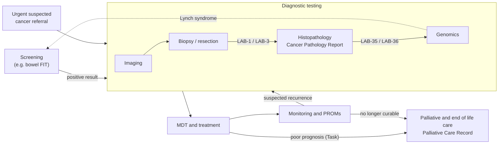

<b>Proof of concept.</b> This implementation guide is a demonstration only. It is
<b>not</b> an authoritative source, is not endorsed by NHS England, the National
Disease Registration Service or HL7, and must not be used for implementation or
clinical purposes. The authoritative sources are the standards each page references -
for example the <a href="https://nhsd-proxy.openprescribing.net/ndrs/data/data-sets/cosd/cosd-pathology-user-guide-v5.0/core---pathology">COSD Pathology User Guide</a>
or <a href="https://standards.nhs.uk/published-standards/palliative-care-coordination-core-content">SCCI1580</a>.

Volume 1 describes the care processes around a cancer pathology report: how a person
comes to be tested, how the diagnosis is made and shared, how they are followed up,
and how care continues when the cancer can no longer be cured. Each process has its
own page; this overview shows how they fit together.

### The Processes Together

| Process | Starts with | Main exchanges | Record produced | Page |
|---|---|---|---|---|
| Screening | A national programme invitation (e.g. FIT kit from a bowel screening hub) | Screening result to the GP (EDIFACT NHS004); referral to a screening centre | Screening result | [Cancer Screening](Screening.html) |
| Diagnostic testing | A positive screening result or an urgent suspected cancer referral | Imaging orders and reports; histopathology order and report ([LTW](LTW.html) LAB-1, LAB-3); reflex genomic order ([ILW](ILW.html) LAB-35, LAB-36) | **[Cancer Pathology Report](PathologyReport.html)** (Volume 3); genomic report | [Imaging and Radiology](Imaging.html), [LTW](LTW.html), [ILW](ILW.html), [Genomic Testing and Reporting](Genomics.html) |
| MDT and treatment | The diagnostic results | Treatment itself is outside this guide; blood tests during treatment are LTW orders and results, often across organisations | Integrated stage, treatment plan; laboratory reports | [Cancer Pathway](CancerPathway.html), [Children's Cancer Shared Care](ChildrensCancerSharedCare.html) |
| Monitoring and PROMs | The end of treatment with curative intent | Surveillance tests (blood tests, imaging, colonoscopy) as ordinary LTW orders and results; patient-reported outcomes; remote monitoring | Results; PROM responses; a new Cancer Pathology Report if a recurrence is biopsied | [Cancer Monitoring and Patient-Reported Outcomes](PatientReportedOutcomes.html) |
| Palliative and end of life care | A poor prognosis at the MDT, or monitoring showing the cancer is no longer curable - a **Task** to complete the record | SDC Questionnaire, extraction, FHIR Document, printed copy; retrieval by urgent and emergency care | **[Palliative Care Record](PalliativeCareRecord.html)** (Volume 3) | [Palliative and End of Life Care](EndOfLifeCare.html) |
{:.grid}

### How They Connect

- **Screening leads into diagnostics.** A positive bowel screening result leads to
  colonoscopy at a screening centre; the screening centre endoscopist is the Order
  Placer for histopathology, as for any other referral. Screening results reach
  the GP as a programme category, while the laboratory result behind it is a
  measurement - see [Cancer Screening](Screening.html).
- **The Cancer Pathology Report is the hinge.** It is produced by diagnostic testing,
  triggers the reflex order to genomics, informs the MDT, and is reused later: its
  Primary Cancer Condition can be the primary diagnosis that the palliative care
  plan addresses.
- **Monitoring loops back.** Surveillance tests are ordinary laboratory and imaging
  orders. A suspected recurrence goes back through diagnostic testing and produces a
  new Cancer Pathology Report; COSD records it on a non-primary cancer pathway.
- **Genomics loops back to screening.** A germline result such as Lynch syndrome
  leads to colonoscopic surveillance, which in England is run by the NHS Bowel
  Cancer Screening Programme.
- **Patient-reported outcomes run alongside.** Clinical PROMs and Holistic Needs
  Assessments continue through follow-up and into palliative care; the national
  Cancer Quality of Life Survey reaches patients through the registry.
- **Palliative care closes the pathway.** A poor prognosis raises a Task to complete
  the Palliative Care Record, which is shared as a FHIR Document, printed for the
  home, and amended as the person's wishes and condition change.

### One Person Through the Pathway

The fictitious examples in this guide follow one person, Ned LIVERPOOL:

| When | What happens | Where |
|---|---|---|
| August 2023 | Colonoscopy biopsy of a caecal mass; the Cancer Pathology Report shows adenocarcinoma with loss of MLH1 and PMS2 | [LAB-35](LAB-35.html#example-lynch-syndrome), [Cancer Pathology Report](PathologyReport.html#what-the-reader-sees) |
| August 2023 | Reflex order to the Genomic Laboratory Hub for MLH1 promoter hypermethylation (Lynch syndrome triage) | [LAB-35](LAB-35.html#example-lynch-syndrome), [Home - worked example](index.html#worked-example-lynch-syndrome) |
| 2023 - 2026 | Treatment and follow-up | [Cancer Monitoring and Patient-Reported Outcomes](PatientReportedOutcomes.html) |
| October 2026 | Liver metastases; the MDT judges his prognosis to be last months of life and raises a Task; the Palliative Care Record is completed, shared and printed | [Palliative and End of Life Care](EndOfLifeCare.html#example-scenario), [Palliative Care Record](PalliativeCareRecord.html#what-the-reader-sees) |
| November 2026 | The record is amended - hospice now his first choice, prognosis last weeks of life | [Palliative Care Record examples](PalliativeCareRecord.html#examples) |
{:.grid}

### Across All Processes

The same conventions apply in every process, so that the records produced can be
matched and reused across organisations:

- **Identifiers** with ODS codes as assigning authorities - NHS number, hospital
  number, order and report numbers.
- **Coding** with LOINC for the question and SNOMED CT for the answer, with COSD or
  SCCI1580 data item codes alongside where a national dataset defines the item.
- **HL7 v2 for workflow, FHIR Documents for sharing** - orders and results run on
  IHE LTW and ILW; the reports are shared as FHIR Documents that can be rendered and
  printed - see
  [Sharing and Workflow - Lessons from a Cancer Pathway](PathwayInteroperability.html)
  for why.
