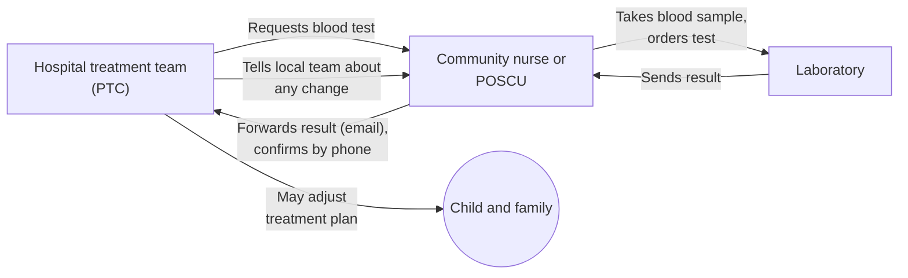
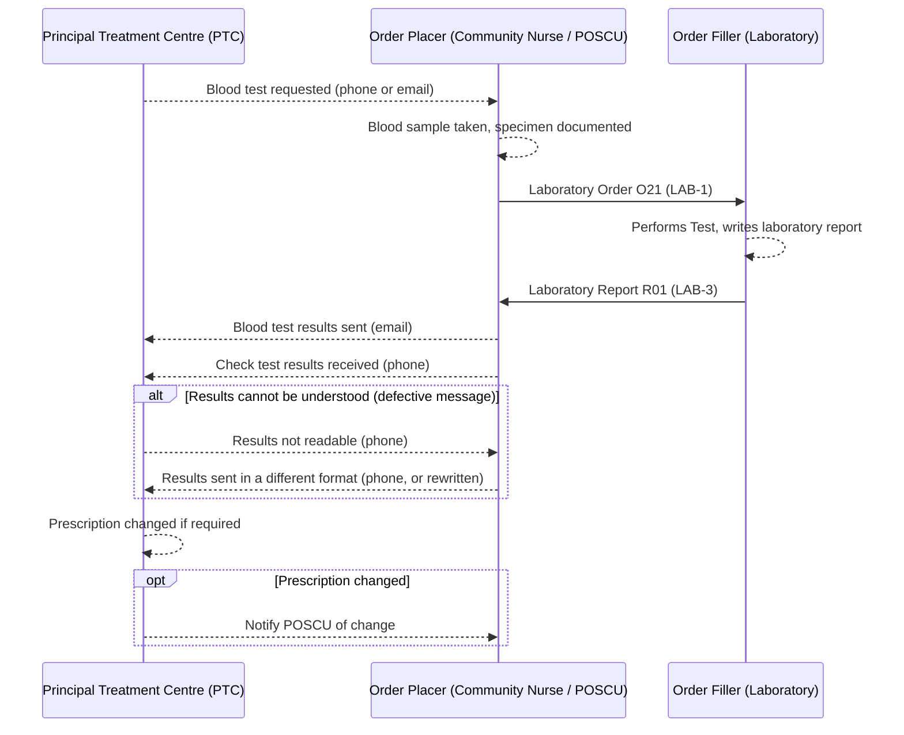
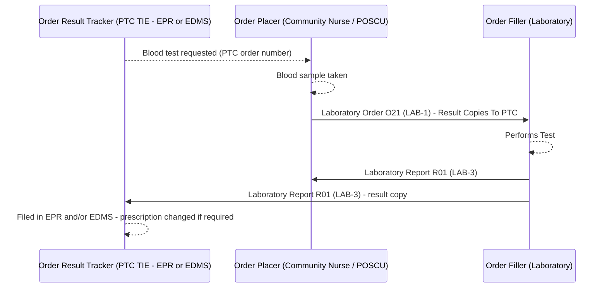
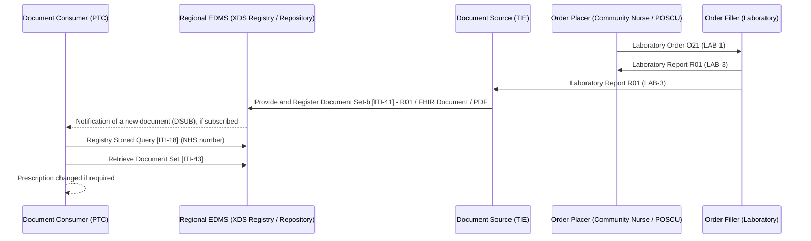

<b>Proof of concept.</b> This implementation guide is a demonstration only. It is
<b>not</b> an authoritative source, is not endorsed by NHS England, the National
Disease Registration Service or HL7, and must not be used for implementation or
clinical purposes. The authoritative sources are the standards each page references -
for example the <a href="https://nhsd-proxy.openprescribing.net/ndrs/data/data-sets/cosd/cosd-pathology-user-guide-v5.0/core---pathology">COSD Pathology User Guide</a>
or <a href="https://standards.nhs.uk/published-standards/palliative-care-coordination-core-content">SCCI1580</a>.

This is currently being elaborated and subject to change.

### References

1. [Test Orders and Results](https://github.com/nw-gmsa/nw-gmsa-use-cases/blob/main/NorthWestChildrensCancer/Test%20Orders%20and%20Results-v11-20240814_100435.pdf) - Interoperability Standards Team, v11, exported 14 August 2024 (North West Children's Cancer): the as-is process and BPMN diagram this use case is based on
2. [Cancer Background Information for Use Cases - NHS North West Children Cancer Example](https://github.com/nw-gmsa/nw-gmsa-use-cases/blob/main/CancerNOS.md) - NW GMSA use cases, the same process in the context of treatment
3. [Laboratory Testing Workflow (LTW)](LTW.html) - the IHE profile the future process follows, and its [Order Results Management [LAB-3]](LAB-3.html) transaction
4. <a href="https://www.macmillan.org.uk/cancer-information-and-support/treatment" _target="_blank">Macmillan - Treatment</a> - blood tests during treatment to check how a patient is responding and to guide medicine doses

### Clinical Pathway Overview

#### What is being tested

Routine **blood tests during a child's cancer treatment** - typically a full blood
count and biochemistry before each cycle of chemotherapy. The results decide
whether treatment can go ahead, or whether the child's prescription needs changing
or the child needs to come into hospital. The child's treatment is managed by a
**Principal Treatment Centre** (PTC), but the blood test is taken closer to home -
at a **Paediatric Oncology Shared Care Unit** (POSCU) or by a community nurse - and
tested by that organisation's laboratory.

#### The end-to-end clinical journey

1. **Blood test requested** - the PTC asks the POSCU or community nurse for a blood test, by phone or email. *(Not an electronic order.)*
2. **Sample taken** - the POSCU or community nurse takes the blood sample and documents the specimen details.
3. **Laboratory order** - the POSCU orders the test from its local laboratory. *(`LAB-1`.)*
4. **Testing** - the laboratory performs the test and writes the laboratory report.
5. **Result to the POSCU** - the laboratory sends the report to the POSCU or community nurse, which placed the order. *(`LAB-3`.)*
6. **Result to the PTC** - the POSCU forwards the result to the PTC by email, and phones to confirm it has been received. If the PTC cannot read it, the result is sent again by phone or rewritten. *(Not electronic.)*
7. **Clinical decision** - the PTC may change the child's prescription, or recall the child into hospital for further tests, and tells the POSCU about any change.

#### Why this matters for developers

- The organisation that **needs** the result (the PTC) is **not** the organisation that **orders** the test (the POSCU), so the laboratory report does not go to the PTC - see [Future Process](#future-process).
- The PTC's request to the POSCU, and the result forwarded to the PTC, are **not electronic** today - phone and email - see [Current Process](#current-process).
- Results the PTC "cannot understand" are "usually due to a defective message" - coding, units and reference ranges matter as much as the transport - see [Data Requirements](#data-requirements).
- These are ordinary laboratory results (`ORU_R01`), not cancer pathology reports - the same [LTW](LTW.html) conventions apply.
- Changing the child's prescription (and telling the POSCU) is a separate closed loop - systemic anti-cancer therapy prescribing - outside this guide.

### Actors

| IHE Actor | Role |
|---|---|
| Order Placer / Order Result Tracker ([LTW](LTW.html#actors-and-transactions)) | Principal Treatment Centre (PTC) - requests testing, acts on results. Today it only requests by phone or email, and receives results by email |
| Order Placer ([LTW](LTW.html#actors-and-transactions)) | Community Nurse / POSCU - places the laboratory order today; specimen collection; relays results and notifications to the PTC |
| Order Filler ([LTW](LTW.html#actors-and-transactions)) | Laboratory serving the POSCU - performs testing, writes the laboratory report |
{:.grid}

### Transactions

| Transaction | Description | Direction |
|---|---|---|
| Not electronic (phone or email) | Blood test request | PTC → Community Nurse / POSCU |
| `LAB-1` | Laboratory Order | Order Placer (POSCU) → Order Filler (Laboratory) |
| `LAB-3` | Laboratory Report | Order Filler (Laboratory) → Order Placer (POSCU) |
| Not electronic (email, then phone) | Laboratory report forwarded, receipt confirmed | Community Nurse / POSCU → PTC |
| Not electronic (phone) | Prescription change notification | PTC → Community Nurse / POSCU |
{:.grid}

Whether the POSCU's `LAB-1` and `LAB-3` are electronic depends on the local order
comms and laboratory - **To confirm**.

### Current Process

#### As is Process

(From the North West Children's Cancer *Test Orders and Results* document, v11)

- Blood test requested by Primary Treatment Centre (PTC)
- Blood sample taken by Community Nurse or Paediatric Oncology Shared Care Unit (POSCU) and the specimen details are documented
- Blood Laboratory Order is created and a laboratory order request is sent to the laboratory
- Blood test performed by laboratory
- Laboratory writes up blood results report (laboratory report)
- Laboratory report sent to Community Nurse or POSCU
- Laboratory report then sent to PTC
- Community Nurse or POSCU calls PTC by phone to notify that the results have been sent and to confirm that they have been received
- If results cannot be understood, PTC will call Community Nurse or POSCU to inform them. This is usually due to a defective message
    - Community Nurse or POSCU sends results in a different format (via telephone or re-writes the results out)
- PTC may edit child's prescription on regimen in light of blood results and may need to recall patient into hospital for additional tests
- If prescription is amended then PTC must notify POSCU

The document's text calls the PTC the *Primary* Treatment Centre and its BPMN
diagram the *Principal* Treatment Centre; *Principal* is used on this page.

#### Blood Test Workflow

The source BPMN diagram as a sequence diagram. Dashed lines are not electronic.

### Future Process

The PTC's need for the result becomes part of the order, so the PTC receives the same
report, coded and readable, without the POSCU forwarding it. There are three options for
how the report reaches the PTC, depending on what the laboratory, the trusts and the
region can support:

| Option | How the PTC gets the result | How the PTC stores it | Notes |
|---|---|---|---|
| 1 - Result copy to the PTC's TIE | The PTC is named on the order as a result copy recipient (HL7 v2 `OBR-28` Result Copies To, with the PTC's ODS code); the laboratory sends the same `ORU_R01` (`LAB-3`) to the POSCU and to the PTC's Trust Integration Engine (TIE) | The PTC's TIE files it in the EPR and/or the trust's local EDMS (electronic document management system) | Smallest change - the POSCU's order comms and laboratory stay the same; needs a point-to-point interface from each laboratory to each PTC |
| 2 - Regional document sharing | A TIE (the laboratory's or the POSCU's) publishes the report to a regional EDMS, such as an [IHE XDS](https://profiles.ihe.net/ITI/TF/Volume1/ch-10.html) document repository and registry ([ITI-41] Provide and Register Document Set-b); the PTC queries and retrieves it ([ITI-18], [ITI-43]), or is notified of new documents (IHE DSUB) | The regional EDMS holds the report as structured data - the `ORU_R01`, or a FHIR Document such as the [Pathology Test Result Composition](StructureDefinition-PathologyTestResultComposition.html) - and/or a PDF; the PTC can also file a copy locally | The report is available to any authorised organisation in the region, not only the PTC - for example the community nurse or a hospice |
| 3 - NHS England Pathology Laboratory Reporting API | Laboratory middleware sends the report as a FHIR Document to the national [Pathology and Laboratory Medicine Reporting API](https://digital.nhs.uk/developer/api-catalogue/pathology-laboratory-reporting); it is stored in Patient Data Manager, with a Multicast Notification Service event | National store (Patient Data Manager) | Sends reports "to the requesting general practice organisation" - tests ordered by a POSCU or a PTC may not be included; secondary care access is not described. In private beta (invite only); replaces the Pathology Messaging EDIFACT API |
{:.grid}

In options 1 and 2 the order still comes from the POSCU. A variant is for the **PTC to
place the order** (`LAB-1`), naming the POSCU or community nurse as specimen collector,
so the report returns to the PTC with a copy to the POSCU. This matches clinical
responsibility, but the local laboratory must accept orders from another organisation.

Option 1:

Option 2:

Each option removes the steps that cause the problems - forwarding by email, phone
confirmation, re-sending and rewriting results. An example option 1 message (a full blood
count with a result copy to the PTC) is on the
[HL7 v2 Pathology Examples](HL7v2.html#laboratory-report-lab-3---full-blood-count-with-result-copy)
page, with the same report as a FHIR Document.

**To confirm:**

- Which laboratories and LIMS serve the POSCUs and community nurses, and whether
  they can send result copies to the PTC (option 1) or accept PTC orders.
- Whether a regional EDMS (XDS) is available across the PTC's and POSCUs' region, and
  which formats it accepts - HL7 v2, FHIR Document, PDF (option 2).
- Whether the NHS England Pathology Laboratory Reporting API will cover tests not
  ordered by a GP, and whether secondary care will be able to read the reports
  (option 3).
- Whether the PTC's order number can be carried through the POSCU's order comms.
- How a prescription change at the PTC should be shared with the POSCU - for example
  through a shared regimen or care plan.
- Which PTCs and POSCUs are involved - the source does not name them.

### Data Requirements

**Status** shows whether something is already in this IG or is an open question.

| Item | Why | How (HL7 v2) | Status |
|---|---|---|---|
| Patient identity | The result must match the right child in both organisations | NHS number, and each organisation's hospital number with its ODS code as assigning authority (`PID-3`) | [LTW](LTW.html) conventions |
| Order numbers | The PTC must match the result to its request | PTC request number (`ORC-2`, PTC ODS code), laboratory number (`ORC-3`, laboratory ODS code) | **Open** - the PTC as Order Placer, or carried through the POSCU order |
| Result recipients | Both organisations receive the same report | `OBR-28` Result Copies To (option 1), the PTC as Order Placer, or a regional EDMS (option 2) | **Open** |
| Specimen collection | Collected by the POSCU or community nurse, not the requester | `SPM` with collection date and time; collector | [LTW](LTW.html) conventions |
| Coded results | So the PTC's system can read them - the "defective message" problem | LOINC for each test (`OBX-3`), UCUM units (`OBX-6`), reference range (`OBX-7`), abnormal flag (`OBX-8`) | [LTW](LTW.html) conventions; local test codes **To confirm** |
{:.grid}

### Relationship to the Cancer Pathway

These are monitoring tests during treatment - the *MDT and treatment* stage of the
[Care Processes Overview](CareProcesses.html). The same pattern - a test ordered by
one organisation, collected by another, with the result needed by a third - recurs
across shared care, and is the reason for result copies in [LAB-3](LAB-3.html).

### Security Considerations

As for the [Laboratory Testing Workflow](LTW.html#security-considerations). Sending
results directly to the PTC replaces forwarding them by email.
