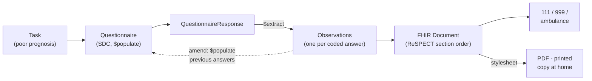
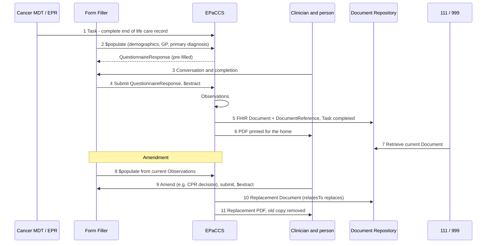

<b>Proof of concept.</b> This implementation guide is a demonstration only. It is
<b>not</b> an authoritative source, is not endorsed by NHS England, the National
Disease Registration Service or HL7, and must not be used for implementation or
clinical purposes. The authoritative sources are the standards each page references -
for example the <a href="https://nhsd-proxy.openprescribing.net/ndrs/data/data-sets/cosd/cosd-pathology-user-guide-v5.0/core---pathology">COSD Pathology User Guide</a>
or <a href="https://standards.nhs.uk/published-standards/palliative-care-coordination-core-content">SCCI1580</a>.

For many patients the cancer pathway ends in palliative and end of life care. An
electronic palliative care co-ordination system (EPaCCS) record makes the person's
preferences, the CPR decision and other advance care planning known to everyone
caring for them - in particular urgent and emergency care. This page describes the
care process: how the record is started from the cancer pathway, captured, shared,
printed and amended. The record itself is in Volume 3,
[Palliative Care Record](PalliativeCareRecord.html).

### Overview

The End of Life API's primary use case was a **111/999 call** for a person with end
of life plans: the urgent care system retrieves the record, the call handler and
paramedics see the prognosis, preferences, CPR decision and home access details,
and the person can be cared for at home in line with their plans rather than
admitted.

The record is **captured** with a Questionnaire, **persisted** as Observations, and
**shared** as a FHIR Document, which can be **printed** for the copy SCCI1580
recommends is kept "in the person's home, at the bedside or where it can be easily
accessed by the relevant carers".

The content of the record - its data items, the FHIR Document and an example
rendering - is described in [Palliative Care Record](PalliativeCareRecord.html).

### Example Scenario

The [example scenario](ExampleScenario-PalliativeCareRecordScenario.html) starts from the
cancer pathway: a poor prognosis (for example *last months of life*, SCCI1580 item
34) at the MDT raises a **Task** to complete the record.

Fictitious instances for each step - the Task, QuestionnaireResponses,
Observations, care plan and both Document versions - are listed in the
[Palliative Care Record examples](PalliativeCareRecord.html#examples).

### Relationship to the Cancer Pathway

- The **Task** that starts the record comes from the cancer pathway: a poor
  prognosis at the MDT, or when [Cancer Monitoring](PatientReportedOutcomes.html#follow-up-after-treatment) shows the
  cancer is no longer curable.
- `$populate` can pre-fill item 26 **primary end of life care diagnosis** from the
  cancer diagnosis - for example the [Cancer Pathology Report](PathologyReport.html)
  morphology and topography.
- [Patient-Reported Outcomes](PatientReportedOutcomes.html#patient-reported-outcome-measures) and Holistic Needs
  Assessments continue alongside.

### Open

- Which system raises the Task - the MDT's EPR, the oncology system or the
  EPaCCS - and who owns it, is **To confirm**.
- Regional care plan services that implement this content (for example the London
  Universal Care Plan) are not covered - **To confirm**.
