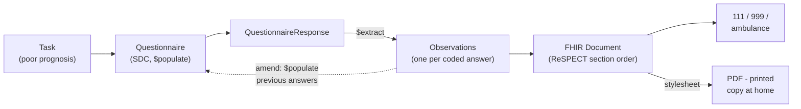

<div class="alert alert-danger" role="alert">
<b>Proof of concept.</b> This implementation guide is a demonstration only. It is
<b>not</b> an authoritative source, is not endorsed by NHS England, the National
Disease Registration Service or HL7, and must not be used for implementation or
clinical purposes. The authoritative source for COSD Pathology is the
<a href="https://nhsd-proxy.openprescribing.net/ndrs/data/data-sets/cosd/cosd-pathology-user-guide-v5.0/core---pathology">COSD Pathology User Guide</a>.
</div>

For many patients the cancer pathway ends in palliative and end of life care. An
electronic palliative care co-ordination system (EPaCCS) record makes the person's
preferences, the CPR decision and other advance care planning known to everyone
caring for them - in particular urgent and emergency care. This content has no
pathology content and is outside the scope of the Cancer Pathology Report model; it
is documented here as a logical model, an SDC Questionnaire and an example scenario.

### Sources and Precedence

| Precedence | Source | Used for |
|---|---|---|
| 1 | [SCCI1580 Palliative Care Co-ordination: Core Content](https://standards.nhs.uk/published-standards/palliative-care-coordination-core-content) - Amd 11/2015, v4.0 ([requirements specification](https://digital.nhs.uk/binaries/content/assets/website-assets/isce/scci1580/1580112015spec.pdf), [corrigendum](https://digital.nhs.uk/binaries/content/assets/website-assets/isce/scci1580/1580112015corrigendum.pdf), January 2016) | **Primary source of requirements** - 16 sections, 60 data items, their data entry status and codes |
| 2 | [PRSB Palliative and End of Life Care Standard](https://theprsb.org/standards/palliativeandendoflifecare/) - build 11.0 | Only content SCCI1580 does not define: CPR decision involvement and review responsibility, mental capacity assessment, contingency plans, palliative care register, document locations |
| - | [FHIR End of Life API](https://webarchive.nationalarchives.gov.uk/ukgwa/20250306144031/https://developer.nhs.uk/apis/eol-alpha/index.html) - NHS Digital, alpha, FHIR STU3, 2019, and its [Questionnaire CareConnect-EOLC-1](https://gist.github.com/KevinMayfield/5b15657ab584a5326c2e5fd84e2a68b8) | A **mapping** only. It used the EoL National Minimum Dataset v2.2, not SCCI1580 v4.0 |
| - | [ReSPECT form](https://www.respectprocess.org.uk/) v3 - Resuscitation Council UK | **Presentation** only: the section order of the FHIR Document. The form is licensed CC BY-NC-ND 4.0, so only its section headings are used |
{:.grid}

### Overview

The End of Life API's primary use case was a **111/999 call** for a person with end
of life plans: the urgent care system retrieves the record, the call handler and
paramedics see the prognosis, preferences, CPR decision and home access details,
and the person can be cared for at home in line with their plans rather than
admitted.

The record is **captured** with a Questionnaire, **persisted** as Observations, and
**shared** as a FHIR Document, which can be **printed** for the copy SCCI1580
recommends is kept "in the person's home, at the bedside or where it can be easily
accessed by the relevant carers".



| Artifact | Role |
|---|---|
| [End of Life Care Record](StructureDefinition-EndOfLifeCareRecord.html) | Logical model: SCCI1580's 16 sections and 60 data items, plus PRSB items where SCCI1580 is silent. Mappings to SCCI1580, PRSB and the 2019 API |
| [End of Life Care](Questionnaire-EndOfLifeCareQuestionnaire.html) Questionnaire | SDC capture form. linkIds are the SCCI1580 item numbers; each item's `definition` points to the logical model; coded items are extracted as Observations |
| [SCCI1580 Data Item](CodeSystem-scci1580-data-item.html) code system | The 60 SCCI1580 data items, used as `Questionnaire.item.code` and `Observation.code` - a local proposal, as SCCI1580 publishes no code system |
| [End of Life Care Observation](StructureDefinition-EndOfLifeCareObservation.html) | Profile for an extracted answer: `code` the SCCI1580 data item, `derivedFrom` the QuestionnaireResponse |
| [End of Life Care Composition](StructureDefinition-EndOfLifeCareComposition.html) | Profile for the Document's Composition: type SNOMED CT `861421000000109` *End of Life Care Coordination Summary*, ordered sections in ReSPECT order ([section codes](CodeSystem-eol-document-section.html)) |
| [End of Life Care Scenario](ExampleScenario-EndOfLifeCareScenario.html) | Example scenario: Task, capture, extraction, Document, print, retrieval and amendment |
{:.grid}

### Example Scenario

The [example scenario](ExampleScenario-EndOfLifeCareScenario.html) starts from the
cancer pathway: a poor prognosis (for example *last months of life*, SCCI1580 item
34) at the MDT raises a **Task** to complete the record.

```mermaid
sequenceDiagram
    participant MDT as Cancer MDT / EPR
    participant FF as Form Filler
    participant E as EPaCCS
    participant C as Clinician and person
    participant DR as Document Repository
    participant UEC as 111 / 999
    MDT->>E: 1 Task - complete end of life care record
    FF->>E: 2 $populate (demographics, GP, primary diagnosis)
    E-->>FF: QuestionnaireResponse (pre-filled)
    C->>FF: 3 Conversation and completion
    FF->>E: 4 Submit QuestionnaireResponse, $extract
    E->>E: Observations
    E->>DR: 5 FHIR Document + DocumentReference, Task completed
    E->>C: 6 PDF printed for the home
    UEC->>DR: 7 Retrieve current Document
    Note over FF,E: Amendment
    FF->>E: 8 $populate from current Observations
    C->>FF: 9 Amend (e.g. CPR decision), submit, $extract
    E->>DR: 10 Replacement Document (relatesTo replaces)
    E->>C: 11 Replacement PDF; old copy removed
```

### Content

The [logical model](StructureDefinition-EndOfLifeCareRecord.html) follows
SCCI1580's sections. Items marked * are mandatory in SCCI1580.

| SCCI1580 section | Data items | Questionnaire | Extracted to |
|---|---|---|---|
| 1 Consent | 1 Consent status* | `s1` | Observation (and `Consent` - **Open**) |
| 2 Record | 2 Record creation date*, 4 Date and time of last amendment* | `s2` | Composition date |
| 3 Plan and requested actions | 3 Planned review date; 44-47 CPR decision, date, review date, document location; PRSB involvement and review responsibility | `s3` | Observations |
| 4 Person demographics | 5-13 Name*, preferred name, birth date*, NHS number* and status*, gender, address*, telephone; 16-17 main carer and availability of carer support* | `s4` | `Patient`, `RelatedPerson`; item 16 coded as an Observation |
| 5 Special requirements | 14 Interpreter, 15 Language, 29 Functional status, 28 Disability, 33 EoLC tool in use; PRSB palliative care register | `s5` | Observations |
| 6 Information and advice given | 18 Carer aware of prognosis, 48 Awareness of CPR decision | `s6` | Observations |
| 7 GP practice | 19 Usual GP name*, 20 Practice details* | `s7` | `Patient.generalPractitioner` |
| 8 Key worker | 21-22 | `s8` | `CareTeam` - **Open** |
| 9 Services and care | 23-25 Care workers and professional group | `s9` | `CareTeam` - **Open** |
| 10 Diagnoses | 26 Primary end of life care diagnosis*, 27 Other diagnoses, 34 Likely prognosis | `s10` | Observations (`Condition` - **Open**) |
| 11 Allergies | 30 Allergies/adverse drug reactions | `s11` | Observation (`AllergyIntolerance` - **Open**) |
| 12 Medications and devices | 31 Anticipatory medicines/just in case box, 32 Location | `s12` | Observations |
| 13 Legal information | 35 Advance statement, 49-50 ADRT, 51-53 LPA for personal welfare; PRSB mental capacity assessment and document locations | `s13` | Observations, `RelatedPerson` |
| 14 Concerns, expectations and wishes | 36-43 Preferred place of death 1st and 2nd choice, 54-57 others to be involved in decisions, 58 Other issues or preferences; PRSB contingency plans | `s14` | Observations, `RelatedPerson` |
| 15-16 After death | 60 Actual place of death, 59 Date of death | `s15` | Observations |
{:.grid}

Each extracted Observation has `code` = the [SCCI1580 data item](CodeSystem-scci1580-data-item.html)
(for example `scci1580-data-item#44` CPR decision), `value` = the answer (for
example SNOMED CT `450476008` Not for cardiopulmonary resuscitation), and
`derivedFrom` = the QuestionnaireResponse.

### The FHIR Document

The Document is a `Bundle` of type `document`. Its Composition's sections follow
the **ReSPECT form's section order**, so the rendered and printed record reads like
the form clinicians and families already know. Each section has a narrative for
display and the Observations as entries.

| ReSPECT section | SCCI1580 items (PRSB) |
|---|---|
| 1 This plan belongs to | 5-13 demographics, 7 preferred name |
| 2 Shared understanding of my health and current condition | 26-27 diagnoses, 34 likely prognosis, 28 disability, 29 functional status, 30 allergies, 31-32 anticipatory medicines; other care planning documents: 35 advance statement, 49-50 ADRT, 51-53 LPA, 33 EoLC tool in use |
| 3 What matters to me in decisions about my treatment and care | 36-43 preferred place of death, 58 other issues or preferences, 35 advance statement requests and preferences |
| 4 Clinical recommendations for emergency care and treatment | 44-47 CPR decision; (PRSB contingency plans) |
| 5 Capacity for involvement in making this plan | 1 consent status (explicit, best interests decision or LPA); (PRSB mental capacity assessment) |
| 6 Involvement in making this plan | 48 awareness of CPR decision, 18 carer aware of prognosis; (PRSB involvement in CPR decision) |
| 7 Clinicians' signatures | `Composition.author` and `attester` |
| 8 Emergency contacts and those involved in discussing this plan | 16-17 main carer, 54-57 others to be involved in decisions, 51-53 LPA, 19-20 GP, 21-22 key worker, 23-25 care workers |
| 9 Form reviewed and remains relevant | 3 planned review date, 4 last amended, 46 CPR review date |
| After death (not on ReSPECT) | 59-60 date and place of death |
{:.grid}

An amendment produces a **new Document** whose Composition `relatesTo` (code
`replaces`) points to the previous one; the previous DocumentReference becomes
`superseded`, and the printed copy in the home is replaced.

For the printed copy, the Document is rendered to PDF with a stylesheet (for
example the FHIR Document XSLT or an HTML template), from the section narratives.

The Composition type is SNOMED CT `861421000000109` *End of Life Care Coordination
Summary*. The UK edition also has `1382601000000107` *ReSPECT (Recommended Summary
Plan for Emergency Care and Treatment) form*, which would suit a document that is a
ReSPECT form rather than an EPaCCS record laid out like one.

### Examples

Fictitious. Ned LIVERPOOL, the patient of the [Lynch syndrome example](LAB-35.html#example-lynch-syndrome),
now has liver metastases; the colorectal MDT judges his prognosis to be *last months
of life*.

| Step | Example |
|---|---|
| 1 Task raised by the oncologist after the MDT | [EolTask](Task-EolTask.html) |
| 3-4 First completion and extraction | [QuestionnaireResponse (first completion)](QuestionnaireResponse-EolQuestionnaireResponse1.html); Observations `EolObs1-*` (for example [CPR decision](Observation-EolObs1-44.html), [likely prognosis](Observation-EolObs1-34.html)) |
| 5 Document version 1 | [EolDocument1](Bundle-EolDocument1.html), indexed by [EolDocumentReference1](DocumentReference-EolDocumentReference1.html) (now superseded) |
| 8-9 Amendment - prognosis *last weeks of life*, hospice now the 1st choice of preferred place of death, functional status 30 | [QuestionnaireResponse (amendment)](QuestionnaireResponse-EolQuestionnaireResponse2.html); amended Observations `EolObs2-*` (for example [preferred place of death](Observation-EolObs2-36.html)) |
| 10 Document version 2, which `replaces` version 1 | [EolDocument2](Bundle-EolDocument2.html), indexed by [EolDocumentReference2](DocumentReference-EolDocumentReference2.html) with the printable PDF |
{:.grid}

The Observations in the examples were generated from the QuestionnaireResponses the
way `$extract` would: one per answered item with a SCCI1580 code. Unchanged
answers are carried into version 2 unchanged; changed answers are new Observations
with status `amended`.

### Changes from the 2019 API

SCCI1580 v4.0 is organised differently from the EoL National Minimum Dataset v2.2
the 2019 API used. Following the order of precedence:

- **Added from SCCI1580:** record creation and amendment dates, planned review
  date, CPR document location, NHS number status, address, main carer and
  availability of carer support, carer aware of prognosis, GP, key worker, care
  workers, primary and other diagnoses, allergies, advance statement, ADRT document
  location, LPA authority, preferred place of death 2nd choice with organisation
  and address, others to be involved in decisions, date and actual place of death.
- **Replaced by SCCI1580 codes:** consent (the four SCCI1580 consent statuses),
  prognosis (*last days, weeks, months of life*; the Gold Standards Framework is
  item 33 EoLC tool in use), preferred place of death (death location type plus
  three SNOMED CT codes), functional status (Australia-modified Karnofsky only).
- **Kept from PRSB:** palliative care register, CPR decision involvement and review
  responsibility, mental capacity assessment, contingency plans (replacing the
  API's problems and advised interventions).
- **Not in SCCI1580 or PRSB, so dropped:** ReSPECT care priority scale, reason for
  CPR status, professional endorsing the CPR status, consent discussion details,
  Electronic Frailty Index, other documents list.

### Terminology

Codes are from SCCI1580 and its corrigendum, checked on tx.fhir.org (SNOMED CT UK
edition 20261021). Four are inactive and are left out:

| Code | Display | SCCI1580 item |
|---|---|---|
| `751961000000104` | Relative aware of prognosis - replaced by `473316003` (corrigendum) | 18 |
| `711951000000105` | Carer unaware of prognosis | 18 |
| `766391000000108` | Preferred place of death: patient declined discussion | 36, 40 |
| `852031000000100` | Under care of physician | 24 |
{:.grid}

The death location type codes (10 Hospital ... 50 Other) are defined locally in
[Death Location Type](CodeSystem-eol-death-location-type.html), as no FHIR code
system for the NHS Data Model and Dictionary DEATH LOCATION TYPE CODE was found -
**To confirm**.

### Relationship to the Cancer Pathway

- The **Task** that starts the record comes from the cancer pathway: a poor
  prognosis at the MDT, or when [Cancer Monitoring](CancerMonitoring.html) shows the
  cancer is no longer curable.
- `$populate` can pre-fill item 26 **primary end of life care diagnosis** from the
  cancer diagnosis - for example the [Cancer Pathology Report](PathologyReport.html)
  morphology and topography.
- [Patient-Reported Outcomes](PatientReportedOutcomes.html) and Holistic Needs
  Assessments continue alongside.

### Open

- Whether related items (for example 44-47, the CPR decision with its date, review
  date and document location) should be one Observation with components rather
  than one Observation each.
- Which items should also become specific resources - `Consent` (1),
  `Condition` (26-27), `AllergyIntolerance` (30), `CareTeam` (21-25).
- ReSPECT content that is in neither SCCI1580 nor PRSB - the care priority scale,
  CPR recommendation for adults or children, clinician signatures - needs a ReSPECT
  model, which the Resuscitation Council UK would own.
- PRSB has worked on an update to SCCI1580; whether a newer SCCI1580 version
  exists is **To confirm**.
