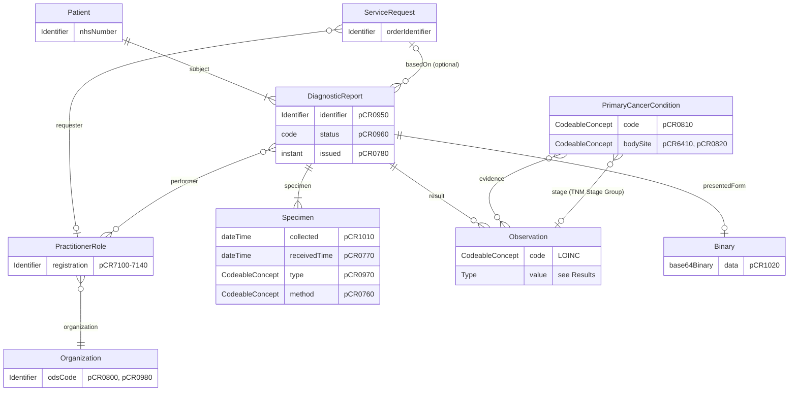
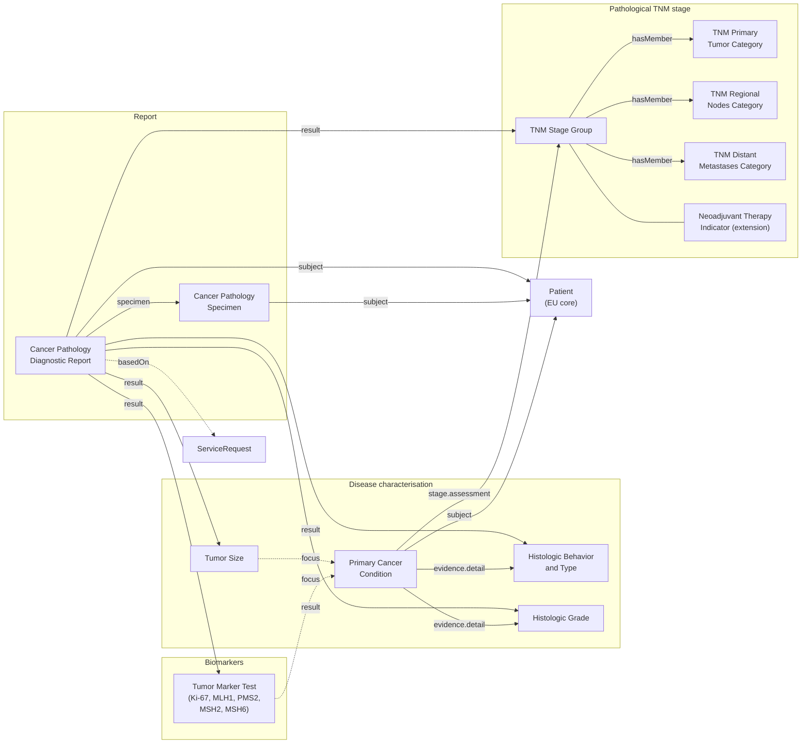
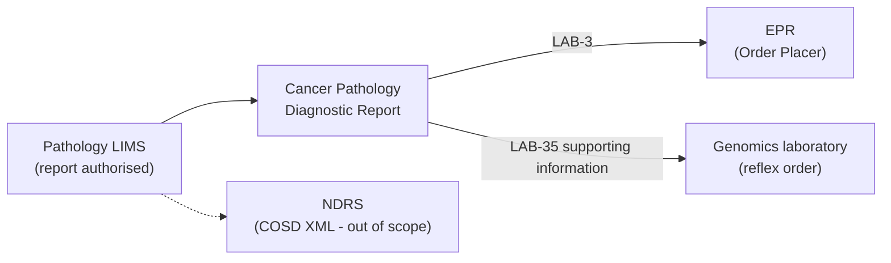
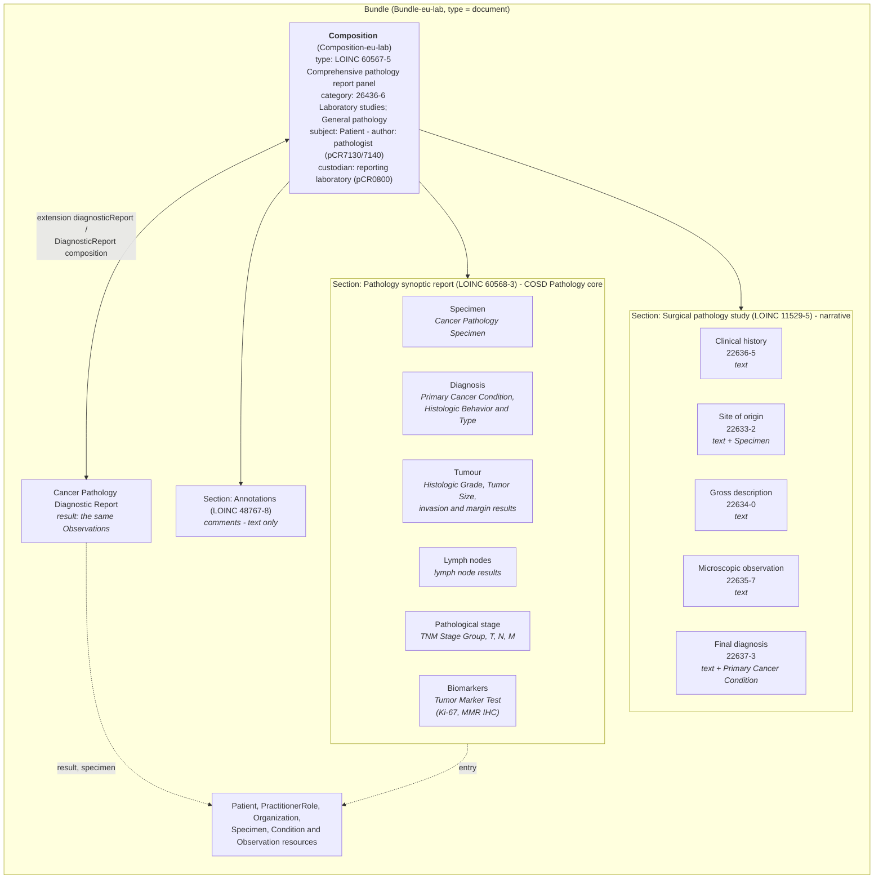

<b>Proof of concept.</b> This implementation guide is a demonstration only. It is
<b>not</b> an authoritative source, is not endorsed by NHS England, the National
Disease Registration Service or HL7, and must not be used for implementation or
clinical purposes. The authoritative source for COSD Pathology is the
<a href="https://nhsd-proxy.openprescribing.net/ndrs/data/data-sets/cosd/cosd-pathology-user-guide-v5.0/core---pathology">COSD Pathology User Guide</a>.

This page describes the common requirement for a **Cancer Pathology Report**: the
structured content a pathology laboratory reports for a cancer specimen, based on
[COSD Pathology](https://nhsd-proxy.openprescribing.net/ndrs/data/data-sets/cosd/cosd-pathology-user-guide-v5.0/core---pathology)
(v5) **Core - Pathology**. Unlike the NW Genomics
[Genomic Test Report](https://nw-gmsa.github.io/en/Questionnaire-GenomicTestReport.html),
it is not modelled as a Questionnaire. The content is defined by the
[Pathology Report logical model](StructureDefinition-PathologyReport.html), and
exchanged using the [profiles](profiles.html) in this guide.

The report has the same basic shape as other diagnostic reports - patient,
order, report, specimen and results - with the cancer-specific content in the
results.

### References

- [COSD Pathology User Guide v5 - Core Pathology](https://nhsd-proxy.openprescribing.net/ndrs/data/data-sets/cosd/cosd-pathology-user-guide-v5.0/core---pathology) - National Disease Registration Service (primary source of requirements)
- [Royal College of Pathologists cancer datasets](https://www.rcpath.org/profession/guidelines/cancer-datasets-and-tissue-pathways.html) - COSD Pathology v5 is aligned with these
- [HL7 Europe Laboratory Report](https://hl7.eu/fhir/laboratory/) (HL7 FHIR) - base profiles
- [HL7 Europe Base](https://hl7.eu/fhir/base/) (HL7 FHIR) - base profiles
- [HL7 Europe Common Cancer Model](https://build.fhir.org/ig/hl7-eu/cancer-common/) - cancer diagnosis model
- [mCODE (minimal Common Oncology Data Elements)](https://hl7.org/fhir/us/mcode/) STU4 (HL7 FHIR) - profile alignment
- [HL7 US Cancer Pathology Data Sharing](https://hl7.org/fhir/us/cancer-reporting/index.html) (HL7 FHIR) - pathology report pattern
- [HL7 Lab Results Interface (LRI)](https://www.hl7.org/implement/standards/product_brief.cfm?product_id=279) (HL7 v2.5.1) - `ORU_R01` mappings (indicative)

### Domain Archetype

A **level 2** (field-level) view of the cancer pathology report, showing the
FHIR resources it uses and their key attributes. Each attribute is labelled with
its COSD Pathology data item.

`ServiceRequest` is **optional** (`basedOn`): it is only present when the report
answers an order the reporting system knows about.

**Structured and unstructured.** As for any laboratory report, the coded results
(`DiagnosticReport.result`) sit alongside the full human-readable report
(`DiagnosticReport.presentedForm`, typically a PDF) - COSD Pathology Report Text
(pCR1020). The coded results support computer processing and onward use, such as
a reflex order to genomics; the PDF remains the report clinicians read. For
document sharing (for example IHE XDS/MHD), see the Document Perspective of
[HL7 Europe Laboratory Report](https://hl7.eu/fhir/laboratory/).

### Detailed Model

Cardinalities are from the [logical model](StructureDefinition-PathologyReport.html).
HL7 v2 mappings are **indicative**.

#### Patient

<b>HL7 FHIR Profile:</b> <a href="http://hl7.eu/fhir/base/StructureDefinition/patient-eu-core">Patient (EU core)</a>

| Name | COSD | Value Set / Data Type | Cardinality | HL7 v2 ORU_R01 | HL7 FHIR |
|---|---|---|---|---|---|
| NHS Number | - | Identifier | 1..1 | PID-3 | Patient.identifier |
{:.grid}

COSD Pathology core identifies the patient through the COSD submission record, not
the pathology items, so no patient items are listed here.

#### Diagnostic Workflow

<b>HL7 FHIR Profile:</b> <a href="StructureDefinition-CancerPathologyDiagnosticReport.html">Cancer Pathology Diagnostic Report</a>

| Name | COSD | Value Set / Data Type | Cardinality | HL7 v2 ORU_R01 | HL7 FHIR |
|---|---|---|---|---|---|
| Service Report Identifier | pCR0950 | Identifier | 0..1 | OBR-3 | DiagnosticReport.identifier |
| Pathology Observation Report Identifier | pCR6220 | Identifier | 0..1 | OBR-3 (local) | DiagnosticReport.identifier |
| Service Report Status | pCR0960 | [COSD Service Report Status](ValueSet-cosd-service-report-status.html) | 1..1 | OBR-25 | DiagnosticReport.status (FHIR status; COSD code by mapping) |
| Investigation Result Date | pCR0780 | date | 0..1 | OBR-22 | DiagnosticReport.issued |
| Pathology Report Text | pCR1020 | string / Attachment | 0..1 | OBX (type ED or TX) | DiagnosticReport.presentedForm |
| Consultant (Pathology Test Requested By) | pCR7100 / pCR7120 | Identifier (e.g. GMC) | 0..1 | OBR-16 | ServiceRequest.requester (PractitionerRole) |
| Organisation Site Identifier (Pathology Test Requested By) | pCR0980 | Identifier (ODS site code) | 0..1 | ORC-21 | ServiceRequest.requester (PractitionerRole).organization |
| Consultant (Pathologist) | pCR7130 / pCR7140 | Identifier (e.g. GMC) | 0..1 | OBR-32 | DiagnosticReport.performer (PractitionerRole) |
| Organisation Identifier (Reporting Pathologist) | pCR0800 | Identifier (ODS code) | 1..1 | OBX-23 | DiagnosticReport.performer (Organization) |
{:.grid}

#### Specimen

<b>HL7 FHIR Profile:</b> <a href="StructureDefinition-CancerPathologySpecimen.html">Cancer Pathology Specimen</a> (mCODE Human Specimen)

| Name | COSD | Value Set / Data Type | Cardinality | HL7 v2 ORU_R01 | HL7 FHIR |
|---|---|---|---|---|---|
| Sample Collection Date | pCR1010 | date | 0..1 | SPM-17 | Specimen.collection.collectedDateTime |
| Sample Receipt Date | pCR0770 | date | 0..1 | SPM-18 | Specimen.receivedTime |
| Specimen Nature | pCR0970 | [COSD Specimen Nature](ValueSet-cosd-specimen-nature.html) | 1..1 | SPM-4 | Specimen.type |
| Pathology Investigation Type | pCR0760 | [COSD Pathology Investigation Type](ValueSet-cosd-pathology-investigation-type.html) | 1..1 | SPM-7 | Specimen.collection.method |
{:.grid}

#### Diagnosis

<b>HL7 FHIR Profile:</b> <a href="StructureDefinition-PrimaryCancerCondition.html">Primary Cancer Condition</a> and <a href="StructureDefinition-HistologicBehaviorAndType.html">Histologic Behavior and Type</a>

| Name | COSD | Value Set / Data Type | Cardinality | HL7 v2 ORU_R01 | HL7 FHIR |
|---|---|---|---|---|---|
| SNOMED Version (Pathology) | pCR6990 | [COSD SNOMED Version](ValueSet-cosd-snomed-version.html) | 1..1 | - | Implied by the coding system version |
| Topography (SNOMED) Pathology | pCR6410 | [Cancer Topography](ValueSet-cancer-topography.html) | 0..* | OBX | Condition.bodySite |
| Morphology (SNOMED) Pathology | pCR6420 | [Cancer Morphology](ValueSet-cancer-morphology.html) | 0..* | OBX | Histologic Behavior and Type: Observation.valueCodeableConcept |
| Diagnosis (ICD Pathological) | pCR0810 | [Cancer Diagnosis](ValueSet-cancer-diagnosis.html) | 0..* | OBX | Condition.code |
| Tumour Laterality (Pathological) | pCR0820 | [COSD Tumour Laterality](ValueSet-cosd-tumour-laterality.html) | 1..1 | OBX | Condition.bodySite (laterality qualifier) |
{:.grid}

At least one topography or morphology code is required.

#### Tumour

| Name | COSD | Value Set / Data Type | Cardinality | HL7 v2 ORU_R01 | HL7 FHIR |
|---|---|---|---|---|---|
| Lesion Size (Pathological) | pCR0830 | Quantity (mm) | 0..1 | OBX | [Tumor Size](StructureDefinition-TumorSize.html) |
| Grade of Differentiation (Pathological) | pCR0860 | [COSD Grade of Differentiation](ValueSet-cosd-grade-of-differentiation.html) | 1..1 | OBX | [Histologic Grade](StructureDefinition-HistologicGrade.html) |
| Cancer Vascular or Lymphatic Invasion | pCR0870 | [COSD Cancer Vascular or Lymphatic Invasion](ValueSet-cosd-vascular-or-lymphatic-invasion.html) | 1..1 | OBX | Observation (no mCODE profile) |
| Perineural Invasion | pCR1100 | [COSD Perineural Invasion](ValueSet-cosd-perineural-invasion.html) | 1..1 | OBX | Observation (no mCODE profile) |
| Excision Margin | pCR0880 | [COSD Excision Margin](ValueSet-cosd-excision-margin.html) | 1..1 | OBX | Observation (no mCODE profile) |
| Excision Margin (Circumferential) | pCR1150 | [COSD Excision Margin (Circumferential)](ValueSet-cosd-circumferential-margin.html) | 1..1 | OBX | Observation (no mCODE profile) |
| Synchronous Tumour Indicator | pCR0840 | [COSD Synchronous Tumour Indicator](ValueSet-cosd-synchronous-tumour-indicator.html) | 1..1 | OBX | Observation (no mCODE profile) |
{:.grid}

#### Lymph Nodes

| Name | COSD | Value Set / Data Type | Cardinality | HL7 v2 ORU_R01 | HL7 FHIR |
|---|---|---|---|---|---|
| Number of Nodes Examined | pCR0890 | integer | 0..1 | OBX | Observation (no mCODE profile) |
| Number of Nodes Positive | pCR0900 | integer | 0..1 | OBX | Observation (no mCODE profile) |
| Sentinel Lymph Nodes Examined Number | pCR1110 | integer | 0..1 | OBX | Observation (no mCODE profile) |
| Sentinel Lymph Nodes Positive Number | pCR1120 | integer | 0..1 | OBX | Observation (no mCODE profile) |
| Post SLNB Completion Lymphadenectomy - Nodes Examined Number | pCR1130 | integer | 0..1 | OBX | Observation (no mCODE profile) |
| Post SLNB Completion Lymphadenectomy - Nodes Positive Number | pCR1140 | integer | 0..1 | OBX | Observation (no mCODE profile) |
{:.grid}

#### Pathological TNM Stage

| Name | COSD | Value Set / Data Type | Cardinality | HL7 v2 ORU_R01 | HL7 FHIR |
|---|---|---|---|---|---|
| TNM Coding Edition | pCR6980 | [COSD TNM Coding Edition](ValueSet-cosd-tnm-coding-edition.html) | 1..1 | OBX | Observation.method on each TNM profile |
| TNM Version Number (Pathological) | pCR6820 | string | 0..1 | OBX | Observation.method on each TNM profile |
| T Category (Pathological) | pCR0910 | CodeableConcept | 0..1 | OBX | [TNM Primary Tumor Category](StructureDefinition-TNMPrimaryTumorCategory.html) |
| N Category (Pathological) | pCR0920 | CodeableConcept | 0..1 | OBX | [TNM Regional Nodes Category](StructureDefinition-TNMRegionalNodesCategory.html) |
| M Category (Pathological) | pCR0930 | CodeableConcept | 0..1 | OBX | [TNM Distant Metastases Category](StructureDefinition-TNMDistantMetastasesCategory.html) |
| TNM Stage Grouping (Pathological) | pCR0940 | CodeableConcept | 0..1 | OBX | [TNM Stage Group](StructureDefinition-TNMStageGroup.html) |
| Neoadjuvant Therapy Indicator | pCR1000 | [COSD Neoadjuvant Therapy Indicator](ValueSet-cosd-neoadjuvant-therapy-indicator.html) | 1..1 | OBX | [Neoadjuvant Therapy Indicator](StructureDefinition-NeoadjuvantTherapyIndicator.html) extension on TNM Stage Group |
{:.grid}

#### Biomarkers

<b>HL7 FHIR Profile:</b> <a href="StructureDefinition-TumorMarkerTest.html">Tumor Marker Test</a>

| Name | COSD | Value Set / Data Type | Cardinality | HL7 v2 ORU_R01 | HL7 FHIR |
|---|---|---|---|---|---|
| Ki-67 Indicator | pCR7000 | [COSD Ki-67 Indicator](ValueSet-cosd-ki67-indicator.html) | 1..1 | OBX | Tumor Marker Test, or dataAbsentReason when not done |
| Ki-67 Result | pCR7010 | Quantity (%) | 0..1 | OBX | Tumor Marker Test (LOINC 29593-1).valueQuantity |
| MLH1 Nuclear Expression Intact | pCR7020 | [COSD Nuclear Expression Intact](ValueSet-cosd-nuclear-expression-intact.html) | 1..1 | OBX | Tumor Marker Test (LOINC 81691-8) |
| PMS2 Nuclear Expression Intact | pCR7030 | [COSD Nuclear Expression Intact](ValueSet-cosd-nuclear-expression-intact.html) | 1..1 | OBX | Tumor Marker Test (LOINC 81694-2) |
| MSH2 Nuclear Expression Intact | pCR7040 | [COSD Nuclear Expression Intact](ValueSet-cosd-nuclear-expression-intact.html) | 1..1 | OBX | Tumor Marker Test (LOINC 81692-6) |
| MSH6 Nuclear Expression Intact | pCR7050 | [COSD Nuclear Expression Intact](ValueSet-cosd-nuclear-expression-intact.html) | 1..1 | OBX | Tumor Marker Test (LOINC 81693-4) |
{:.grid}

Loss of MMR nuclear expression is the trigger for the Lynch syndrome reflex order
to genomics - see [Pathology to Genomics Reflex](https://github.com/nw-gmsa/nw-gmsa-use-cases/blob/main/PathologyToGenomicsReflex.md).

### Results

`DiagnosticReport.result` carries the coded findings, one Observation per item,
each with a fixed LOINC code where one exists:

| Result | Profile | Code | mCODE equivalent |
|---|---|---|---|
| Histologic type and behaviour | [Histologic Behavior and Type](StructureDefinition-HistologicBehaviorAndType.html) | LOINC `31206-6` | Histologic Behavior and Type |
| Grade | [Histologic Grade](StructureDefinition-HistologicGrade.html) | LOINC `33732-9` | Histologic Grade (NCIt `C18000`) |
| Tumour size | [Tumor Size](StructureDefinition-TumorSize.html) | LOINC `21889-1` | Tumor Size |
| pT | [TNM Primary Tumor Category](StructureDefinition-TNMPrimaryTumorCategory.html) | LOINC `21899-0` | TNM Primary Tumor Category |
| pN | [TNM Regional Nodes Category](StructureDefinition-TNMRegionalNodesCategory.html) | LOINC `21900-6` | TNM Regional Nodes Category |
| pM | [TNM Distant Metastases Category](StructureDefinition-TNMDistantMetastasesCategory.html) | LOINC `21901-4` | TNM Distant Metastases Category |
| Stage group | [TNM Stage Group](StructureDefinition-TNMStageGroup.html) | LOINC `21902-2` | TNM Stage Group |
| Ki-67, MMR IHC | [Tumor Marker Test](StructureDefinition-TumorMarkerTest.html) | [Cancer Pathology Tumor Marker Test](ValueSet-CancerPathologyTumorMarkerTest.html) | Tumor Marker Test |
| Invasion, margins, synchronous tumour, lymph nodes | `Observation-resultslab-eu-lab` | Not yet assigned | None |
{:.grid}

#### Profile relationships

How the result profiles relate to each other, the report, the specimen and the
diagnosis - in the style of the mCODE
[profile overview diagram](https://build.fhir.org/ig/HL7/fhir-mCODE-ig/). Arrow
labels are the FHIR elements that hold the reference. Every Observation also has
`subject` (Patient) and `specimen` (Cancer Pathology Specimen), which are left
off the diagram to keep it readable. Dashed arrows are optional links used by
mCODE that the profiles here do not constrain. Click a box to open its profile.

`DiagnosticReport.result` may also reference the TNM category Observations
directly, and the COSD items with no mCODE profile (invasion, margins,
synchronous tumour, lymph nodes) as plain `Observation-resultslab-eu-lab` results.

#### Report flow

### FHIR Document

The report above is a `DiagnosticReport` with its results - suited to workflow
exchange. For **document sharing** (for example IHE XDS/MHD, or the NHS England
National Record Locator) the same report would be sent as a FHIR Document: a
`Bundle` of type `document` with a `Composition` as its first entry.

Neither COSD Pathology nor any other source defines a document layout for a COSD
report. A layout can be **inferred** by combining three sources:

| Source | What it gives |
|---|---|
| [HL7 Europe Laboratory Report](https://hl7.eu/fhir/laboratory/) `Composition-eu-lab` and `Bundle-eu-lab` | The base profiles. Sections are limited to **two levels**: the top level for the study or specialty, the second for report items. An **Annotations** section (LOINC `48767-8`) carries comments as text only. The Composition and the `DiagnosticReport` reference each other |
| HL7 US [Cancer Pathology Data Sharing](https://hl7.org/fhir/us/cancer-reporting/index.html) US Pathology Composition | The cancer pathology pattern: `type` is the checklist used (a CAP eCP form code), `author` is the pathologist, an extension links to the `DiagnosticReport`, and section entries follow the checklist sections. Its breast cancer example has one section, LOINC `26436-6` Laboratory studies (set), whose entries are Observations for each checklist section |
| [NAACCR Volume V](LAB-3.html) | The LOINC codes for the narrative report sections and for the synoptic report, used the same way in HL7 v2 |
{:.grid}

#### Inferred layout

<b>Proposal.</b> This layout is inferred for this proof of concept. It is profiled
as the <a href="StructureDefinition-CancerPathologyComposition.html">Cancer Pathology
Composition</a>.

| Level | Section | Code | Content | Source of the code |
|---|---|---|---|---|
| 1 | Surgical pathology study | LOINC `11529-5` | The narrative report | NAACCR Volume V `OBR-4` |
| 2 | Clinical history | LOINC `22636-5` | Text | NAACCR Volume V `OBX-3` |
| 2 | Site of origin | LOINC `22633-2` | Text; entry Cancer Pathology Specimen | NAACCR Volume V `OBX-3` |
| 2 | Gross description | LOINC `22634-0` | Text | NAACCR Volume V `OBX-3` |
| 2 | Microscopic observation | LOINC `22635-7` | Text | NAACCR Volume V `OBX-3` |
| 2 | Final diagnosis | LOINC `22637-3` | Text (COSD pCR1020 report text); entry Primary Cancer Condition | NAACCR Volume V `OBX-3` |
| 1 | Pathology synoptic report | LOINC `60568-3` | The COSD Pathology core content | NAACCR Volume V `OBR-4` |
| 2 | Specimen, Diagnosis, Tumour, Lymph nodes, Pathological stage, Biomarkers | **Not yet assigned** - the groups of the [logical model](StructureDefinition-PathologyReport.html) | Entries: the [result profiles](#results) | US IG uses licensed CAP eCP section codes; COSD has no section codes. Local codes would be needed |
| 1 | Annotations | LOINC `48767-8` | Text only, no entries | `Composition-eu-lab` |
{:.grid}

#### What the reader sees

A FHIR Document is a real document. Every section carries its own
human-readable narrative (`Composition.section.text`), and a viewer shows those
narratives in order, top to bottom, like the pages of a printed report. The
coded entries sit behind the narrative for computers to use, but **the reader
never needs to see them**.

The mock below is the fictitious [PathDocument](#examples) example - Ned
LIVERPOOL's caecal biopsy, the report in the [LAB-35](LAB-35.html#example-lynch-syndrome)
Lynch syndrome example - laid out the way a document viewer would show the
section narratives of its [Cancer Pathology Composition](StructureDefinition-CancerPathologyComposition.html).
The small grey labels show the Composition element, the section slice and its LOINC
code, and the entries behind each block - a real viewer would not show them.

Composition.title &middot; type LOINC 60567-5 &middot; identifier H23-41022 &middot; custodian 690S0

  

    
Histopathology Report

    
Manchester Royal Infirmary Laboratory (690S0)

  

  
FICTITIOUS EXAMPLE

Composition.subject (Patient) &middot; identifier &middot; date &middot; status &middot; DiagnosticReport.basedOn (order)

<table style="width:100%; font-size:14px; margin-bottom:14px; border:none;">
<tr><td style="border:none; padding:2px 8px 2px 0;"><b>Patient</b></td><td style="border:none;">LIVERPOOL, Ned (M)</td><td style="border:none;"><b>NHS Number</b></td><td style="border:none;">973 738 3206</td></tr>
<tr><td style="border:none; padding:2px 8px 2px 0;"><b>Date of birth</b></td><td style="border:none;">18-Jun-1942</td><td style="border:none;"><b>Report number</b></td><td style="border:none;">H23-41022</td></tr>
<tr><td style="border:none; padding:2px 8px 2px 0;"><b>Order number</b></td><td style="border:none;">1583320 (R0A)</td><td style="border:none;"><b>Report status</b></td><td style="border:none;">Final</td></tr>
<tr><td style="border:none; padding:2px 8px 2px 0;"><b>Collected</b></td><td style="border:none;">14-Aug-2023</td><td style="border:none;"><b>Authorised</b></td><td style="border:none;">21-Aug-2023 09:00</td></tr>
</table>

section[surgicalPathology] &middot; Surgical pathology study (LOINC 11529-5)

Report

section[clinicalHistory] &middot; 22636-5 &middot; section.text

<b>Clinical details.</b> Change in bowel habit. Colonoscopy: ulcerated mass in the caecum.

section[siteOfOrigin] &middot; 22633-2 &middot; section.text, entry Cancer Pathology Specimen

<b>Specimen.</b> A: Caecal mass, colonoscopic biopsies, collected 14-Aug-2023. Fixed in buffered 10% formalin.

section[grossDescription] &middot; 22634-0 &middot; section.text

<b>Macroscopy.</b> Four cores of tan tissue, 2 to 5 mm. All embedded in block A1.

section[microscopicObservation] &middot; 22635-7 &middot; section.text

<b>Microscopy.</b> Fragments of large bowel mucosa infiltrated by an adenocarcinoma, forming irregular glands with a desmoplastic stroma. Tumour-infiltrating lymphocytes are prominent. Mismatch repair immunohistochemistry: MLH1 loss of nuclear expression; PMS2 loss of nuclear expression; MSH2 retained; MSH6 retained.

section[finalDiagnosis] &middot; 22637-3 &middot; section.text (pCR1020), entry Primary Cancer Condition

<b>Diagnosis.</b> Caecum, biopsy: adenocarcinoma. Mismatch repair deficient (loss of MLH1 and PMS2). MLH1 promoter hypermethylation testing requested to assess for Lynch syndrome.

section[synopticReport] &middot; Pathology synoptic report (LOINC 60568-3) &middot; entries: Specimen, Primary Cancer Condition, Histologic Behavior and Type, 4 &times; Tumor Marker Test

Cancer data summary

<table style="width:100%; font-size:14px; margin-bottom:12px;">
<tr><td>Specimen nature (pCR0970)</td><td>Primary tumour</td></tr>
<tr><td>Investigation type (pCR0760)</td><td>Biopsy</td></tr>
<tr><td>Topography (pCR6410)</td><td>Caecum structure</td></tr>
<tr><td>Diagnosis (pCR0810)</td><td>C18.0 Caecum</td></tr>
<tr><td>Morphology (pCR6420)</td><td>Adenocarcinoma</td></tr>
<tr><td>MLH1 nuclear expression intact (pCR7020)</td><td><b>No - lost</b></td></tr>
<tr><td>PMS2 nuclear expression intact (pCR7030)</td><td><b>No - lost</b></td></tr>
<tr><td>MSH2 nuclear expression intact (pCR7040)</td><td>Yes</td></tr>
<tr><td>MSH6 nuclear expression intact (pCR7050)</td><td>Yes</td></tr>
</table>

Composition.author, attester (legal) &middot; custodian

Reported and authorised by: Dr Anika FICTITIOUS (GMC C2468013), Consultant Histopathologist &middot; 21-Aug-2023 09:00 &middot; Manchester Royal Infirmary Laboratory

**Reading the example**

- The **header** comes from the Composition and its `subject`. The order number
  comes from the [Diagnostic Report](DiagnosticReport-PathDiagnosticReport.html)
  (`basedOn`), which the Composition references through its `diagnosticReport`
  extension; the two share the report number `H23-41022` and type `60567-5`, as the
  HL7 Europe Laboratory Bundle rules require.
- The **Report** sections are narrative only, apart from the specimen and the
  diagnosis, which also reference the coded resources.
- The **Cancer data summary** is the synoptic report section. Its narrative is
  generated from its entries - the same resources the Diagnostic Report has as
  `specimen` and `result` - so a receiver can read the text or use the codes.
- The **supplementary report** (tumour assessment for molecular testing, block A1,
  tumour cell content 40%) shown on [LAB-35](LAB-35.html#the-same-report-human-readable)
  is not in this example: tumour cell content is not a COSD core item - see
  [LAB-35 Gaps](LAB-35.html#gaps).

**Points to note**

- `Composition-eu-lab` binds `category` (specialty) to a value set that has
  *General pathology* but not *Histopathology* (SNOMED CT `394597005`), and its
  study types have no pathology study, so *Laboratory studies (set)* is used, as
  in the US example. HL7 Europe Laboratory excludes histopathology from its scope.
- The US IG puts the checklist structure inside the entries (section Observations
  with `hasMember`). Here the synoptic report section's entries are the result
  profiles directly; second-level sections for the COSD groups (specimen,
  diagnosis, tumour, lymph nodes, stage, biomarkers) would need local section codes.
- The structured entries are the **same resources** the `DiagnosticReport`
  references, so a receiver can use either view.

### Examples

- [LAB-35 - Lynch Syndrome](LAB-35.html#example-lynch-syndrome) - a colorectal
  cancer biopsy with MMR loss, as HL7 v2 prior results in a reflex order to
  genomics, with the same report in human-readable form.

- [PathDocument](Bundle-PathDocument.html) - the same Lynch syndrome biopsy report as
  a FHIR Document: the [Cancer Pathology Composition](StructureDefinition-CancerPathologyComposition.html)
  (narrative surgical pathology sections and a synoptic report section) and the
  [Cancer Pathology Diagnostic Report](DiagnosticReport-PathDiagnosticReport.html) referencing each other, with the
  [specimen](Specimen-PathSpecimenH23-41022.html),
  [primary cancer condition](Condition-PathPrimaryCancerCondition.html),
  [histologic type](Observation-PathHistologicType.html) and the four MMR
  [tumour marker results](Observation-PathMLH1.html). The patient is the same
  person as the [Palliative Care Record](PalliativeCareRecord.html#examples) examples.
