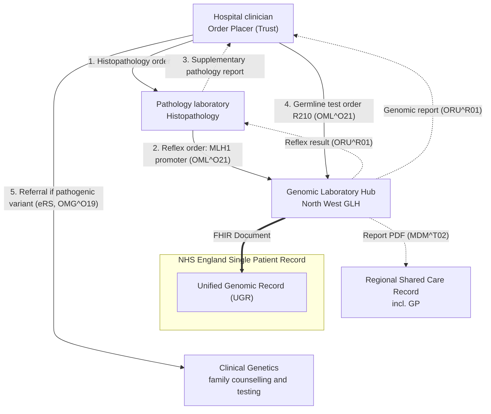
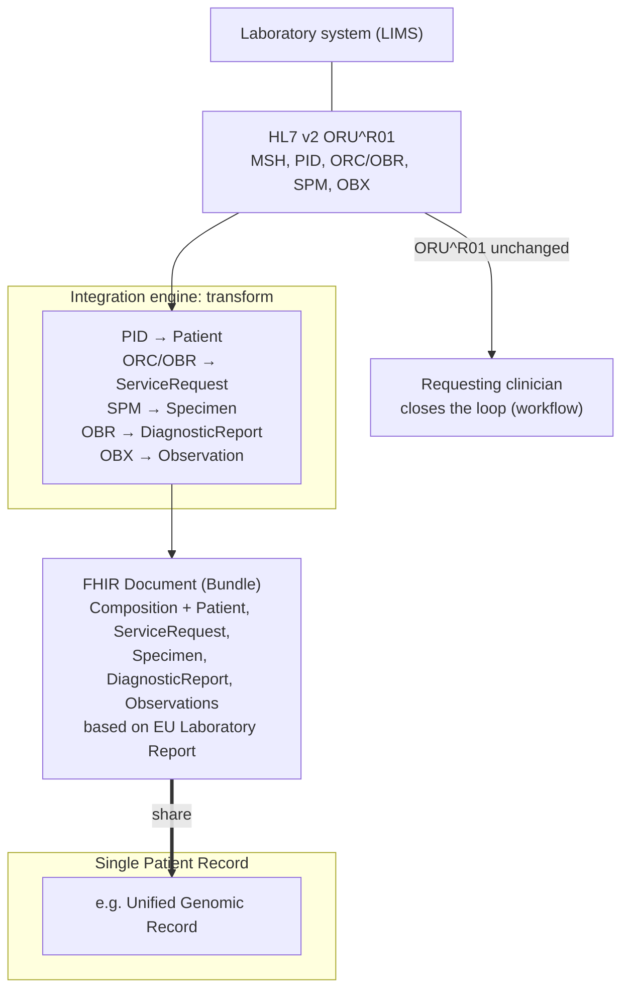

<div class="alert alert-danger" role="alert">
<b>Proof of concept.</b> This implementation guide is a demonstration only. It is
<b>not</b> an authoritative source, is not endorsed by NHS England, the National
Disease Registration Service or HL7, and must not be used for implementation or
clinical purposes. The authoritative sources are the standards each page references -
for example the <a href="https://nhsd-proxy.openprescribing.net/ndrs/data/data-sets/cosd/cosd-pathology-user-guide-v5.0/core---pathology">COSD Pathology User Guide</a>
or <a href="https://standards.nhs.uk/published-standards/palliative-care-coordination-core-content">SCCI1580</a>.
</div>


This page sets out why this guide uses **HL7 v2 for workflow and FHIR Documents for
sharing**. It is adapted from an article written after following a family member
through a cancer pathway. Seen from the family's side, these gaps were hard to miss:

- Many care providers had no access to a patient summary record.
- Some hospital consultants could not see the cancer pathology reports, discharge
  letters or progress notes produced by other hospitals involved in the same care.
- Care coordination was mostly manual rather than automated.
- Related care needs were often picked up only once they had become a problem, for
  example nutritional decline that was not addressed until it began contributing to
  falls.
- End of life care information was mostly on paper. Where it was recorded
  electronically, it sat in a single system that other care providers could not
  access (see [Palliative and End of Life Care](EndOfLifeCare.html)).

### In Brief

- **Sharing is being fixed.** NHS England's Single Patient Record will address much
  of the data sharing problem, using European FHIR standards for patient summaries
  and laboratory reports.
- **Coordination is not.** The orders, referrals and reports that move a patient
  along a pathway are a separate problem. In diagnostics they run on HL7 v2, and FHIR
  is not replacing it.
- **Europe is the reference point.** Several sources indicate a preference for
  following HL7 Europe FHIR guides, such as the
  [Laboratory Report](https://build.fhir.org/ig/hl7-eu/laboratory/) and
  [Patient Summary](https://build.fhir.org/ig/hl7-eu/eps/en/introduction.html), and
  IHE profiles over UK Core.
- **The cost is in the conversion.** Much of the FHIR for the Single Patient Record
  will be created by converting HL7 v2. Every NHS Trust and diagnostic service faces
  that cost, and any gaps in their v2 carry straight into the FHIR.
- **Standardising v2 pays twice.** A modest level of HL7 v2 standardisation (unique
  identifiers using ODS codes, and common clinical coding) can reduce conversion
  costs and improve clinical pathway support at the same time.
- **A UK cancer pathology standard is needed.** An English or UK equivalent of the
  HL7 US [Cancer Pathology Data Sharing](https://hl7.org/fhir/us/cancer-reporting/index.html)
  guide, built from COSD/NDRS data standards, would support the Single Patient
  Record, HL7 v2 and the 10-year cancer plan. This guide is a proof of concept of
  that idea.
- **LOINC is a low-cost start.** Several systems already support LOINC, so it may be
  the cheapest way to introduce clinical coding into interoperability.

### Where the Single Patient Record Helps

NHS England's Single Patient Record will start to resolve many of the data sharing
problems:

| Content | Expected basis | Status |
|---|---|---|
| Patient summary | International Patient Summary, possibly with the [HL7 Europe Patient Summary](https://build.fhir.org/ig/hl7-eu/eps/en/introduction.html) at its core | Very likely |
| Pathology and genomic reports | [HL7 Europe Laboratory Report](https://build.fhir.org/ig/hl7-eu/laboratory/) | Understood from NHS England to be all but confirmed - **To confirm** |
| Radiology | [HL7 Europe Imaging Report](https://hl7.eu/fhir/imaging/1.0.0-ballot/en/index.html) | No news yet; the trend points this way - **Open** |
{:.grid}

From a pathway perspective this tackles data sharing across the whole pathway. It
will take time to deliver, but it is the right direction.

### Sharing Is Only Half of the Problem

What the Single Patient Record does not directly tackle is care coordination, which
typically involves a large number of **closed loop referrals**. Online shopping is a
familiar closed loop: an order is placed, fulfilled, and the goods arrive back.
Healthcare works the same way. Someone places an order or referral, the patient is
treated or a test is carried out, and a report is sent back to the person who asked:

- **GP referral:** a GP refers a patient via the e-Referral Service (eRS), and
  receives a transfer of care report (hospital discharge report) back.
- **Laboratory test:** a clinician places a laboratory order through order comms, and
  receives a laboratory report back ([LTW](LTW.html) LAB-1 and LAB-3).

In diagnostic testing almost all of these orders and reports are exchanged as HL7 v2
messages. They are so well established that they are unlikely to be replaced by FHIR.
What is more likely is that the results messages (ORU^R01) are transformed into FHIR
Documents based on the [EU Laboratory Report](https://build.fhir.org/ig/hl7-eu/laboratory/)
and [EU Hospital Discharge Report](https://build.fhir.org/ig/hl7-eu/hdr/).

<div class="alert alert-info" role="alert">
<b>In short:</b> HL7 v2 keeps the day-to-day clinical workflow running; FHIR
Documents carry the results of that workflow into the Single Patient Record.
</div>

### Example: Lynch Syndrome and Colorectal Cancer

The [Lynch syndrome](index.html#worked-example-lynch-syndrome) scenario used in this
guide walks through the referrals, orders and reports involved, and shows where the
Single Patient Record fits:

1. A colonoscopy biopsy is sent to histopathology.
2. Pathology finds loss of mismatch repair (MMR) proteins and places a reflex genomic
   order (MLH1 promoter test) with the Genomic Laboratory Hub
   ([LAB-35](LAB-35.html#example-lynch-syndrome)). The result comes back to pathology
   ([LAB-36](LAB-36.html)).
3. A supplementary pathology report goes back to the clinician.
4. The clinician orders germline testing for Lynch syndrome. The genomic report comes
   back to the clinician, a PDF goes to the regional shared care record, and a FHIR
   Document goes to the Unified Genomic Record (UGR).
5. If a pathogenic variant is found, the family is referred to clinical genetics.



Solid lines are orders and referrals; dashed lines are reports coming back.

The scenario does not cover every closed loop. It starts with a referral from primary
care into secondary care; the imaging used to collect the sample is a closed loop in
its own right ([Imaging and Radiology](Imaging.html)); and it does not show the full
blood counts that are often taken frequently during a diagnostic pathway (see
[the example below](#full-blood-count)).

It does show how genomic results will reach the UGR, part of the Single Patient Record.
The feeds into UGR are likely to be delivered over the next year. The genomic report is
sent to UGR as a [FHIR Document](https://nw-gmsa.github.io/en/Bundle-FHIRDocumentGeneticReportBundle2.html)
(see [Genomic Testing and Reporting](Genomics.html)).

### Behind the Reports: HL7 v2 as the Workflow Core

The workflow that moves a patient through diagnostics runs on HL7 v2, and
standardising how it is used is cheaper than replacing it.

HL7 v2 is built into almost every laboratory system, order comms, patient
administration system and EPR in the NHS. Its order and report messages already handle
the workflow: who placed the order, who is filling it, its status, and the report that
comes back. Replacing that across every NHS Trust and diagnostic service would be slow
and expensive, and would bring little benefit to the workflow itself.

This is not a preference for older technology. HL7 v2 is preferred because it is
**already in place** around pathways. It is often assumed not to be there, or to be on
its way out, because for many years it has been described as being replaced - first by
HL7 v3, then CDA, now FHIR. That replacement has not happened.

What v2 needs is to be used consistently, so it works between any NHS Trust and any
diagnostic service. North West Genomics, working with NHS Trusts, has suggested a small
number of changes that make a big difference:

| Convention | Example | Why |
|---|---|---|
| ODS codes as assigning authorities for patient identifiers | `7742315^^^R0A^MR`; hospital spell `SP2308140915^^^R0A^AN` | A hospital number (MRN) such as 7742315 is only unique within one trust; with the ODS code it is unique across the NHS |
| ODS codes as assigning authorities for order numbers | Order Placer Number `1583320^R0A` (Trust); Filler Order Number `H23-41022^690S0` (laboratory) | Orders can be matched across organisations, which is what closes the loop |
| LOINC for the question in OBX-3 | `81691-8` MLH1 protein presence by immune stain, answer `Absent` in OBX-5 | A common, low-cost code for what was asked |
| National code systems where they exist | SNOMED CT and ICD-O-3 for tumour site and morphology; COSD codes alongside LOINC in OBX-3 | Brings registry standards upstream into the pathway |
| Local codes where national ones are missing | `HISTO`, `MMR`, `TMA`, tumour cell content | Shows exactly where national coding is needed |
{:.grid}

The histopathology result from the Lynch syndrome scenario, sent as the prior result
in the reflex order, is shown with these conventions in
[LAB-35 - Example: Lynch Syndrome](LAB-35.html#example-lynch-syndrome), with the same
data as a human-readable report in
[The same report, human readable](LAB-35.html#the-same-report-human-readable).

#### Full Blood Count

The same applies outside genomics. NHS England's Pathology FHIR Implementation Guide
includes an [example Full Blood Count report](https://simplifier.net/guide/pathology-fhir-implementation-guide/Home/FHIRAssets/AllAssets/Profiles/Examples/Bundles/Bundle-FBC-Report-Example?version=0.5.1),
and reports like this are very likely to be part of the Single Patient Record. The
message below reverse engineers the HL7 v2 ORU^R01 that would sit behind it, using the
same conventions (fictitious; LOINC codes checked on tx.fhir.org, SNOMED CT codes as in
the FHIR example):

```
MSH|^~\&|LIMS|Y8J7D|GPSYSTEM|B82033|20220209111700+0000||ORU^R01^ORU_R01|urn:uuid:e96634d8-0fe6-4954-b2d5-755a7787b987|T|2.5.1|||AL
PID|1||9727710859^^^NHS^NH
PD1|||PICKERING MEDICAL PRACTICE^^B82033^^^ODS
ORC|RE|REQ-20220129-000012^B82033|REP-20220209-001369^Y8J7D||CM||||20220207091700+0000|||C1008215^GASKELL^Gale^^^Dr^^^GMC|||||||||PICKERING MEDICAL PRACTICE^^B82033^^^ODS
OBR|1|REQ-20220129-000012^B82033|REP-20220209-001369^Y8J7D|1022441000000101^FBC - full blood count^SNM3^57021-8^CBC W Auto Differential panel - Blood^LN|||20220208102300+0000||||||Tired all the time, shortness of breath, arrhythmia|||C1008215^GASKELL^Gale^^^Dr^^^GMC||||||20220209111700+0000||HM|F
OBX|1|NM|6690-2^Leukocytes [#/volume] in Blood by Automated count^LN^1022541000000102^Total white cell count^SNM3||4.76|10*9/L^^UCUM|4-11||||F|||20220208102300+0000
OBX|2|NM|789-8^Erythrocytes [#/volume] in Blood by Automated count^LN^1022451000000103^Red blood cell count^SNM3||3.63|10*12/L^^UCUM|4.1-5.1|L|||F|||20220208102300+0000
OBX|3|NM|718-7^Hemoglobin [Mass/volume] in Blood^LN^1022431000000105^Haemoglobin estimation^SNM3||108|g/L^^UCUM|120-150|L|||F|||20220208102300+0000
OBX|4|NM|4544-3^Hematocrit [Volume Fraction] of Blood by Automated count^LN^1022291000000105^Haematocrit^SNM3||0.352|L/L^^UCUM|0.36-0.46|L|||F|||20220208102300+0000
OBX|5|NM|787-2^MCV [Entitic mean volume] in Red Blood Cells by Automated count^LN^1022491000000106^MCV - Mean corpuscular volume^SNM3||97|fL^^UCUM|80-100||||F|||20220208102300+0000
OBX|6|NM|785-6^MCH [Entitic mass] by Automated count^LN^1022471000000107^MCH - Mean corpuscular haemoglobin^SNM3||29.8|pg^^UCUM|27-32||||F|||20220208102300+0000
OBX|7|NM|786-4^MCHC [Entitic Mass/volume] in Red Blood Cells by Automated count^LN^1022481000000109^MCHC - Mean corpuscular haemoglobin concentration^SNM3||307|g/L^^UCUM|315-345|L|||F|||20220208102300+0000
OBX|8|NM|777-3^Platelets [#/volume] in Blood by Automated count^LN^1022651000000100^Platelet count^SNM3||143|10*9/L^^UCUM|140-400||||F|||20220208102300+0000
OBX|9|NM|751-8^Neutrophils [#/volume] in Blood by Automated count^LN^1022551000000104^Neutrophil count^SNM3||2.66|10*9/L^^UCUM|2-7||||F|||20220208102300+0000
OBX|10|NM|731-0^Lymphocytes [#/volume] in Blood by Automated count^LN^1022581000000105^Lymphocyte count^SNM3||0.7|10*9/L^^UCUM|1-3|L|||F|||20220208102300+0000
OBX|11|NM|742-7^Monocytes [#/volume] in Blood by Automated count^LN^1022591000000107^Monocyte count^SNM3||1.3|10*9/L^^UCUM|0.2-1|H|||F|||20220208102300+0000
OBX|12|NM|711-2^Eosinophils [#/volume] in Blood by Automated count^LN^1022561000000101^Eosinophil count^SNM3||0.07|10*9/L^^UCUM|0.02-0.5||||F|||20220208102300+0000
OBX|13|NM|704-7^Basophils [#/volume] in Blood by Automated count^LN^1022571000000108^Basophil count^SNM3||0.03|10*9/L^^UCUM|0.01-0.1||||F|||20220208102300+0000
SPM|1|SPC-REQ-20220208-000016&B82033^SPC-Lab-20220208-001397&Y8J7D||122555007^Venous blood specimen^SNM3|||||||||||||20220208102300+0000|20220208160300+0000
```

Comparing the two:

| Aspect | NHS England FHIR example | HL7 v2 with these conventions |
|---|---|---|
| Coding | SNOMED CT only | LOINC for the question, with SNOMED CT alongside |
| Specimen | Text only ("Venous blood specimen") | SNOMED CT coded (`122555007`) |
| Identifiers | Local URL systems containing the ODS code, e.g. `http://Y8J7D-pathlab001.com/report` | The ODS code is the assigning authority: `REP-20220209-001369^Y8J7D` |
| Provenance | Records that it was produced by transformation - the FHIR was created from another message | The source message |
{:.grid}

It also shows a low haemoglobin (108 g/L), the kind of finding watched during a
diagnostic pathway.

#### From ORU^R01 to FHIR Document

This message is the stage before the transformation into a FHIR Document. It is the
route many NHS Trusts and their suppliers will follow. So rather than FHIR replacing
HL7 v2, FHIR will quite often be **created from** HL7 v2. If the v2 data model has a
problem, such as an identifier with no assigning authority or a local code, the FHIR
will have it too.



<div class="alert alert-info" role="alert">
<b>FHIR is often built from HL7 v2: a data model issue in v2 becomes a data model
issue in FHIR.</b>
</div>

Taken together, this is close to an NHS guide to
[IHE Laboratory Testing Workflow (LTW)](https://wiki.ihe.net/index.php/Laboratory_Testing_Workflow),
the international profile for laboratory orders and results between order placers,
order fillers and the systems that use the results. The Lynch syndrome scenario already
follows its transactions: [LAB-1](LAB-1.html) for orders, [LAB-3](LAB-3.html) for
results, and [LAB-35](LAB-35.html)/[LAB-36](LAB-36.html) for the reflex sub-order and
its result. Adapted for the NHS, with ODS codes, NHS numbers, LOINC and SNOMED CT, it
provides the groundwork for the Single Patient Record: consistent orders and reports,
ready to be turned into FHIR Documents. See [LTW](LTW.html) and [ILW](ILW.html).

### Implementation Challenges

The main obstacles are not technical but about standards: who defines orders and
reports, how they are coded, and whether those standards serve the pathway or only
downstream repositories.

#### Few National Standards for Orders and Reports

Across most of the pathway England has no established national standard for orders and
reports, in either HL7 v2 or FHIR. Central NHS bodies are unlikely to produce HL7 v2
standards. That need not be a blocker: most interoperability standards share the same
underlying model, so a FHIR standard can be back-ported to HL7 v2.

Genomics is the exception. NHS England Genomics is developing national standards for
genomic orders and reports. North West Genomics, working with NHS Trusts, is
back-porting these to HL7 v2, and where HL7 v2 shows up elements missing from the FHIR,
suggesting improvements back to it.

Outside genomics, the nearest HL7 v2 equivalent is the Digital Health and Care Wales
(DHCW) Report specification, which this implementation also draws on.

#### Data Standards Sit Downstream of the Pathway

Some data standards do exist, such as those from the National Disease Registration
Service (NDRS), but they mostly focus on data repositories rather than on pathways and
HL7 messaging. Early experiments with AI suggest it may be possible to bring these
standards upstream and fit them into HL7 v2 (and FHIR), for example COSD codes carried
alongside LOINC in the OBX ([LAB-35](LAB-35.html#example-lynch-syndrome)).

The NHS Federated Data Platform (FDP) is another downstream repository. Unlike NDRS,
which has quite extensive data standards, FDP's are less mature: the SERVICE_REQUEST in
its NHS Canonical Data Model is less developed than the HL7 v2 ORC (and FHIR
ServiceRequest) equivalents.

Clinical coding systems such as LOINC and SNOMED CT are also designed to sit upstream,
where a test is ordered and a result is produced. In the NHS they mostly do not yet, and
local codes are still common. Some downstream interfaces, such as the NHS England
Pathology API, do include SNOMED CT - but the HL7 v2 ORU^R01 used to build that FHIR
payload should be SNOMED CT coded too.

<div class="alert alert-info" role="alert">
<b>We need interoperability data standards, not API standards.</b>
</div>

#### A UK Standard for Cancer Pathology Data

One high-level requirement stands out, for the Single Patient Record (as FHIR
Documents), for HL7 v2 (as a back-port), and to support England's 10-year cancer plan:
an English or UK equivalent of the HL7 US
[Cancer Pathology Data Sharing](https://hl7.org/fhir/us/cancer-reporting/index.html)
implementation guide. That guide sets out how structured cancer pathology data (the
synoptic report) is sent as a FHIR Document from laboratory systems to electronic
health records and cancer registries, with defined data items, codes and value sets.

A UK version can be built from the existing COSD and NDRS data standards, bringing
registry standards upstream into the pathway. This guide's
[Cancer Pathology Report](StructureDefinition-CancerPathologyComposition.html) is a proof of concept of that approach.

<div class="alert alert-info" role="alert">
<b>We need a UK cancer pathology data standard, built from COSD/NDRS, that works in
both FHIR Documents and HL7 v2.</b>
</div>

#### Terminology: LOINC and SNOMED CT Together

LOINC and SNOMED CT will probably need to be used together. Most SNOMED CT coding in
England has been shaped by the needs of data repositories (and of electronic patient
records in primary care). In interoperability and workflow contexts it has numerous
gaps.

This matters most for Observations, the individual results within a report. Each
Observation is a question with an answer. LOINC is designed to code the question;
SNOMED CT is well suited to coding the answer:

| | Code system | Example | HL7 v2 | FHIR |
|---|---|---|---|---|
| Question | LOINC | Mismatch repair protein immunohistochemistry | OBX-3 | `Observation.code` |
| Answer | SNOMED CT | Loss of MLH1 expression | OBX-5 | `Observation.value[x]` |
{:.grid}

There is also a cost argument. Several systems already support LOINC, so it may be a
cheaper way to introduce clinical coding and improve the semantic standards of
interoperability. See [Terminology](terminology.html).

<div class="alert alert-info" role="alert">
<b>For Observations, LOINC asks the question and SNOMED CT answers it.</b>
</div>

#### HL7 v2 and FHIR: Complementary, Not a Straight Replacement

Central NHS bodies tend to view HL7 v2 as something to be replaced. In practice FHIR is
solving the problems v2 struggles with, principally sharing data, as with the Single
Patient Record.

Repeated attempts to replace HL7 v2 (first with HL7 v3 and CDA, now with FHIR) have had
an unwanted side effect: the basics of workflow interactions have been lost sight of.
These are mostly understood already; they work much like the online shopping analogy
above.

Many staff in hospital trusts understand the core data model for orders and reports, and
what a report needs to include. They may describe it in HL7 v2 terms, which can prompt
a "we're doing FHIR now" response. That misses the point. Terms such as **Order Placer
Number** and **Medical Record Number (MRN)** are used everywhere in healthcare IT; they
should be embraced, not replaced. This workflow knowledge is widespread, and it applies
whichever standard is used - HL7 v2, FHIR, DICOM or IHE profiles. It is a pathway
requirement, not a technology choice.

The usual argument for moving to FHIR - that no two HL7 v2 implementations are the
same - is reversed here: in practice HL7 v2 order and report implementations are more
uniform than FHIR ones. Where FHIR has replaced v2 there have often been numerous data
modelling issues. HL7 v2 was designed to support clinical workflow; base FHIR (and UK
Core) often lacks detail about how interoperability works across an enterprise. That may
be enough for an individual system or service, but not for the NHS as a whole.

<div class="alert alert-info" role="alert">
<b>Support the whole pathway, not individual computer systems.</b>
</div>

### Tips

North West Genomics is likely to be among the first diagnostic services sending to the
Single Patient Record and the Unified Genomic Record. Two tips from that work so far:

- **Start from what systems actually supply.** Keep analysis and requirements as close
  as possible to the data systems already send, in many cases HL7 v2. That holds even
  when the end product is FHIR: start from HL7 v2 to avoid unnecessary technical debt.
- **Read the Macmillan guides first.**
  [Macmillan Cancer Support's information](https://www.macmillan.org.uk/cancer-information-and-support)
  gives plain-language descriptions of the tests, treatments and processes these
  pathways support.

### Cost

- Every NHS Trust and diagnostic service will carry the cost of converting HL7 v2 into
  FHIR for the Single Patient Record.
- HL7 v2 is still required to support the pathway itself. In this area FHIR is not
  replacing v2; it sits alongside it.
- A level of standardisation around HL7 v2 - unique identifiers and common clinical
  coding, with LOINC as a low-cost starting point - could reduce those costs while
  improving support for clinical pathways.

<div class="alert alert-info" role="alert">
<b>Standardising HL7 v2 is not a step backwards: it lowers the cost of the Single
Patient Record and makes clinical pathways work better.</b>
</div>
