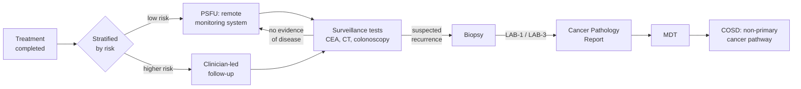
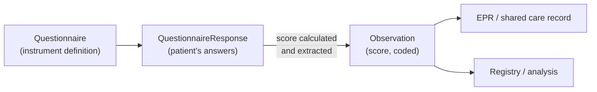

<div class="alert alert-danger" role="alert">
<b>Proof of concept.</b> This implementation guide is a demonstration only. It is
<b>not</b> an authoritative source, is not endorsed by NHS England, the National
Disease Registration Service or HL7, and must not be used for implementation or
clinical purposes. The authoritative sources are the standards each page references -
for example the <a href="https://nhsd-proxy.openprescribing.net/ndrs/data/data-sets/cosd/cosd-pathology-user-guide-v5.0/core---pathology">COSD Pathology User Guide</a>
or <a href="https://standards.nhs.uk/published-standards/palliative-care-coordination-core-content">SCCI1580</a>.
</div>

<div class="alert alert-warning" role="alert">
<b>Draft</b> - first analysis, using colorectal cancer as the example.
</div>

After treatment with curative intent, patients are monitored to detect recurrence.
Monitoring is a series of ordinary tests - blood tests, imaging and endoscopy -
tracked over several years, alongside what patients report about their symptoms
and quality of life. When a test suggests the cancer has come back, a biopsy
produces a new [Cancer Pathology Report](StructureDefinition-CancerPathologyComposition.html), so monitoring leads
back into this guide.

Patient-reported outcome measures (PROMs) are **outside the scope of the Cancer
Pathology Report model**: they contain no pathology content. This page records how
they fit the [Cancer Pathway](CancerPathway.html), which instruments are used in
England, and how they are defined in terminologies and FHIR. The PROMs part follows
the layout of the German Medical Informatics Initiative
[PRO implementation guide](https://build.fhir.org/ig/medizininformatik-initiative/kerndatensatzmodul-proms/en/index.html).

### References

- [NICE NG151 Colorectal cancer](https://www.nice.org.uk/guidance/ng151) - follow-up recommendations, summarised in [NICE QS20 Quality statement 4: Follow-up for detecting local recurrence and distant metastases](https://www.nice.org.uk/guidance/qs20/chapter/Quality-statement-4-Follow-up-for-detecting-local-recurrence-and-distant-metastases)
- [Cancer stratified follow-up handbook](https://www.england.nhs.uk/wp-content/uploads/2020/04/cancer-stratified-follow-up-handbook-v1-march-2020.pdf) - NHS England, v1 March 2020, and [Implementing personalised stratified follow-up pathways](https://www.england.nhs.uk/publication/implementing-personalised-stratified-follow-up-pathways/)
- [Cancer-specific electronic patient record where follow-up care can be managed remotely](https://transform.england.nhs.uk/key-tools-and-info/digital-playbooks/cancer-digital-playbook/cancer-specific-electronic-patient-record-to-support-clinical-teams-and-patients-where-follow-up-care-can-be-managed-remotely) - NHS England cancer digital playbook
- [COSD user guide v10 - How to record recurrence, progression and transformations](https://digital.nhs.uk/ndrs/data/data-sets/cosd/cosd-user-guide-v10/introduction---how-to-record-recurrence-progression-and-transformations) - NDRS
- [mCODE Cancer Disease Status](https://hl7.org/fhir/us/mcode/StructureDefinition-mcode-cancer-disease-status.html) - HL7 US
- [Cancer Screening - Lynch syndrome surveillance](Screening.html#lynch-syndrome-surveillance)
- [Cancer Quality of Life Survey](https://nhsd-proxy.openprescribing.net/ndrs/data/data-outputs/cancer-data-hub/cancer-quality-of-life-survey) - NHS England and NDRS ([first data release summary](https://england.nhs.uk/wp-content/uploads/2021/11/Cancer-quality-of-life-survey-summary-report-first-data-release.pdf))
- [MII PRO implementation guide](https://build.fhir.org/ig/medizininformatik-initiative/kerndatensatzmodul-proms/en/index.html) - Medizininformatik-Initiative (Germany), FHIR R4 with Structured Data Capture (SDC); its [scoring](https://build.fhir.org/ig/medizininformatik-initiative/kerndatensatzmodul-proms/en/scoring.html), [EQ-5D-5L](https://build.fhir.org/ig/medizininformatik-initiative/kerndatensatzmodul-proms/en/eq-5d-5l.html) and [EORTC QLQ-C30](https://build.fhir.org/ig/medizininformatik-initiative/kerndatensatzmodul-proms/en/eortc-qlq-c30.html) pages
- [Gravitate Health - EQ-5D-5L Questionnaire](https://build.fhir.org/ig/hl7-eu/gravitate-health-ips/Questionnaire-Questionnaire-EQ5D-5L.html) - HL7 Europe
- [HL7 FHIR Structured Data Capture (SDC)](https://hl7.org/fhir/uv/sdc/) - Questionnaire rendering, calculation and extraction to Observation
- [Mapping PRO questionnaires to SNOMED CT and LOINC](https://medinform.jmir.org/2023/1/e49301) - JMIR Medical Informatics, 2023
- [EuroQol](https://euroqol.org/) and [EORTC Quality of Life Group](https://qol.eortc.org/) - the instrument owners

### Follow-up after Treatment

NHS England's **personalised stratified follow-up** (PSFU) puts patients into
follow-up pathways by risk. Patients assessed as low risk who have finished
treatment move to supported self-management with **remote surveillance**: their
surveillance tests are scheduled and tracked by a **remote monitoring system**
(RMS), and they can contact the team directly if they have symptoms
(patient-initiated follow-up, PIFU). The handbook covers breast, prostate and
colorectal cancer first. NHS England describes extending PSFU, "including patient
initiated follow-up, to all appropriate cancer pathways"
([Living with and beyond cancer](https://www.england.nhs.uk/cancer/living/)).



### Colorectal Cancer Surveillance

From NICE QS20 statement 4 (based on NG151), for adults who have had potentially
curative surgery for non-metastatic colorectal cancer, over the first 3 years. The
exact NG151 wording has not been checked (the NICE site refused automated access) -
**To confirm**.

| Test | Frequency | Exchange | Coding |
|---|---|---|---|
| Serum carcinoembryonic antigen (CEA) | At least every 6 months | Blood sciences order and result - [LTW](LTW.html) LAB-1 / LAB-3 | LOINC `2039-6` Carcinoembryonic Ag [Mass/volume] in Serum or Plasma |
| CT of the chest, abdomen and pelvis | At least 2 in the first 3 years | Imaging order and report - see [Imaging and Radiology](Imaging.html) | - |
| Clearance colonoscopy | Within 1 year of diagnosis | Endoscopy; biopsies to histopathology (LAB-1 / LAB-3) | - |
| Ongoing colonoscopy | Per the BSG/ACPGBI/PHE post-polypectomy and post-colorectal cancer resection surveillance guidelines (2020), cited by QS20 | As above | - |
| Lynch syndrome colonoscopy | Every 2 years, by the NHS Bowel Cancer Screening Programme | See [Cancer Screening](Screening.html#lynch-syndrome-surveillance) | - |
{:.grid}

A CEA result is an ordinary laboratory result (illustrative - the reference range
is laboratory specific):

```
OBX|1|NM|2039-6^Carcinoembryonic Ag [Mass/volume] in Serum or Plasma^LN||3.1|ug/L^microgram per litre^UCUM|<5|N|||F|||20260512
```

It is the **trend** across results, not a single result, that suggests recurrence.

### The Remote Monitoring System in Workflow Terms

The surveillance tests are normal [LTW](LTW.html) orders and results. What PSFU
adds is a system that knows the **schedule** and checks each test was ordered,
done and reviewed, so that patients are not lost to follow-up.

| Question | Status |
|---|---|
| Is the RMS the Order Placer for surveillance tests, or does it prompt the EPR to order them? | **Open** |
| How does the RMS receive results - as the Order Placer, as a result copy recipient (`OBR-28`), or from the EPR? | **Open** |
| Which systems provide remote monitoring? | The PSFU handbook (page 14): "The main cancer IT systems (Somerset Cancer Register and Infoflex) now offer this functionality". Which are used in the North West is **To confirm** |
| Is there a national interface standard for an RMS? | None found |
{:.grid}

If the RMS receives results as a LAB-3 recipient, the coding in this guide - LOINC
for the question, SNOMED CT for the answer, ODS codes as assigning authorities -
lets it match results to the schedule without local mapping.

### Recurrence and the Cancer Pathology Report

A biopsy taken for suspected recurrence is reported like any other specimen, and
gives a new Cancer Pathology Report. Its
[Specimen Nature](ValueSet-cosd-specimen-nature.html) (pCR0970) shows what was
sampled: `2` Further excision of primary tumour, `4` Regional lymph nodes, or
`5` Metastatic site other than regional lymph nodes.

In COSD, "all 'Recurrence' diagnoses" create a record on a **Non-Primary Cancer
Pathway**, recording "the date of the non-primary diagnosis (note: this is the
diagnosis date of the recurrence)", the "Metastatic Type (local, regional or
distant)" and the "Metastatic Site". Progression and transformation are recorded
separately. These names are from the COSD v10 user guide; the COSD item codes are
**To confirm** against the
[COSD v10.2 data set](https://digital.nhs.uk/ndrs/data/data-sets/cosd/cosd-v10.0-downloads).
They are COSD core items, not COSD Pathology items, so they are not in this
guide's model.

### Disease Status

mCODE records the clinician's judgement of the cancer's trend as a
[Cancer Disease Status](https://hl7.org/fhir/us/mcode/StructureDefinition-mcode-cancer-disease-status.html)
Observation: "whether it is stable, worsening (progressing), or improving
(responding)".

| Element | Value |
|---|---|
| `code` | LOINC `97509-4` (tx.fhir.org display: Cancer disease progression) |
| `value` (preferred) | SNOMED CT `268910001` Patient's condition improved, `359746009` stable, `271299001` worsened, `709137006` undetermined |
| `evidenceType` extension (required) | Descendants of SNOMED CT histologic test, cytologic test, anatomic pathology procedure, laboratory data interpretation, clinical examination, imaging and tumor marker measurement |
{:.grid}

The pathology report, a CEA trend and an imaging report are each possible
**evidence** for a disease status. Disease status is not modelled in this guide.

### Patient-Reported Outcomes During Follow-up

Follow-up depends on what patients report as well as on test results. The
[PSFU handbook](https://www.england.nhs.uk/wp-content/uploads/2020/04/cancer-stratified-follow-up-handbook-v1-march-2020.pdf)
expects:

| Element | What the handbook says | Exchange |
|---|---|---|
| End of Treatment Summary | Information on "potential markers of recurrence/secondary cancers and what to do if these are found", "also copied to primary care and incorporated into hospital notes" (page 13); it should include "potential long term/late effects and what to do if symptoms are experienced" (page 18) | A document to the patient and GP - not defined in this guide |
| Patient-initiated follow-up | The patient contacts the team if they notice those markers; "a person is immediately recalled to clinic if there are any surveillance or other results of concern" (page 13) | Patient to care team, e.g. via a patient portal |
| Holistic Needs Assessment (HNA) | "HNA is not a separate activity, it is part of care planning" (page 16); ongoing HNAs help identify consequences of treatment (page 18) | Questionnaire - instrument not specified |
| Patient-reported outcomes | "Monitoring via Patient Reported Outcome tools, online Holistic Needs Assessments and/or patient symptom diaries. Patient portals can also support people's questions" (page 18) | Questionnaire - instruments not named |
| Patient portal | "an effective way for people to access their test results and care record, and to seek online advice and guidance" (page 14) | Part of the remote monitoring system |
{:.grid}

The handbook names no PRO instrument. So the clinical PROMs used in follow-up are a
local choice, and whether they include the instruments
[below](#patient-reported-outcome-measures) (EQ-5D-5L, EORTC QLQ-C30) is
**To confirm**. Whether the remote monitoring system collects them, and
whether any are coded, is also **To confirm**. The national Cancer Quality of Life
Survey, at about 18 months after diagnosis, is separate: it reaches patients
through the registry, not through follow-up.

### Patient-Reported Outcome Measures

PROMs are not a single step at the end of the pathway:

| Kind | Who collects | When | Link to pathology |
|---|---|---|---|
| **National PROMs** - the [Cancer Quality of Life Survey](https://nhsd-proxy.openprescribing.net/ndrs/data/data-outputs/cancer-data-hub/cancer-quality-of-life-survey) | NHS England with NDRS | About **18 months after diagnosis**; EQ-5D and EORTC QLQ-C30 | Patients are identified from cancer registration data and results are analysed by tumour site and stage. The Cancer Pathology Report's diagnosis details (diagnosis date, site, morphology, stage) reach PROMs **through the registry**, not through any exchange in this guide |
| **Clinical PROMs** | The care team | During and after treatment - symptoms, toxicity, quality of life; in follow-up alongside Holistic Needs Assessments and symptom diaries - see [Cancer Monitoring](#patient-reported-outcomes-during-follow-up) | None directly; an exchange between the patient and the care team |
{:.grid}

In FHIR, an instrument is a `Questionnaire`; a patient's answers are a
`QuestionnaireResponse`; scores (and, where useful, individual answers) are
extracted as `Observation`s so they can be trended and queried like any other
result.



### PRO Library

Instruments used by the national survey. Codes checked on tx.fhir.org on
2026-11-21 (SNOMED CT UK edition 20261021); neither instrument has LOINC codes.

| Instrument | Measures | SNOMED CT (UK edition) | LOINC | FHIR Questionnaire | Licence |
|---|---|---|---|---|---|
| [EQ-5D-5L](#eq-5d-5l) | Generic health-related quality of life | Instrument, assessment, each dimension score, index value and VAS | None | MII (production ready), HL7 Europe Gravitate Health | EuroQol - registration required |
| [EORTC QLQ-C30](#eortc-qlq-c30) | Cancer-specific quality of life | `273446001` only - no item or scale codes | None | MII (technical preview) | EORTC - licence required before production use |
{:.grid}

No NHS England or UK Core Questionnaire was found for either instrument, and no
data specification for the Cancer Quality of Life Survey was checked -
**To confirm**.

### EQ-5D-5L

#### Clinical context

Five dimensions - mobility, self-care, usual activities, pain/discomfort,
anxiety/depression - each answered on five levels, plus a visual analogue scale
(EQ VAS, 0 to 100) for overall health today. Results are reported as a five-digit
health profile, a single **index value** derived from the profile using a
population value set, and the VAS. The EQ-5D-3L (three levels) is the earlier
version. Which value set is used for the index in England is **To confirm**.

#### Coding

| SNOMED CT | Display |
|---|---|
| `73041000052103` | EuroQoL five dimension five level questionnaire |
| `838671000000106` | Assessment using EuroQol five dimension self-report questionnaire |
| `821551000000108` | EuroQol five dimension five level mobility score |
| `821561000000106` | EuroQol five dimension five level self-care score |
| `821581000000102` | EuroQol five dimension five level usual activities score |
| `821591000000100` | EuroQol five dimension five level pain discomfort score |
| `821611000000108` | EuroQol five dimension five level anxiety depression score |
| `736534008` | EuroQol five dimension five level index value |
| `736535009` | EuroQol visual analogue score |
| `870621000000108` | EQ-5D (EuroQol five dimension) self-report questionnaire declined |
{:.grid}

These cover each dimension, the index and the VAS as `Observation.code`, so an
extracted EQ-5D-5L result can be fully coded with SNOMED CT.

#### FHIR

The MII guide splits EQ-5D-5L into Questionnaire **variants** from one base
definition: *minimal* (structure only), *displayable* (showing answers already
captured), and *collectable* (validation, required items and a hidden "no answer"
option). Answers use an MII code system with ordinal values, so they can be scored.
The Gravitate Health Questionnaire has the five dimensions and the VAS, each
dimension bound to its own value set.

#### Licence

EuroQol: per the MII guide, "available for non-commercial purposes after
registration without additional license fees". Commercial use, and reproducing the
question wording, need EuroQol's terms - **To confirm** for NHS use.

### EORTC QLQ-C30

#### Clinical context

The core cancer quality of life questionnaire (version 3.0): 30 items, scored into
15 scales. Items 1 to 28 use a 4-point scale and items 29 and 30 a 7-point scale;
each scale is linearly transformed to 0 to 100. Disease- and treatment-specific
modules (for example QLQ-BR23, breast) add to the core.

| Group | Scales |
|---|---|
| Global | Global health status / quality of life |
| Functional (5) | Physical, role, emotional, cognitive, social |
| Symptom (9) | Fatigue, nausea and vomiting, pain, dyspnoea, insomnia, appetite loss, constipation, diarrhoea, financial difficulties |
{:.grid}

#### Coding

Only the instrument itself is coded:

| SNOMED CT | Display |
|---|---|
| `273446001` | European Organisation for Research and Treatment of Cancer - Quality of Life questionnaire |
{:.grid}

There are no SNOMED CT or LOINC codes for the 30 items or the 15 scale scores, so
extracted scores need the EORTC's own identifiers or a local code system (the MII
guide defines its own). This is the main terminology gap for cancer PROMs.

#### FHIR

The MII guide has a QLQ-C30 v3.0 Questionnaire with all 30 items and 15 scale
scores (technical preview). Its scoring follows the EORTC scoring manual, including
the rule that a scale is scored if at least half its items are answered.

#### Licence

EORTC holds the copyright: "EORTC licensing is required before production use"
(MII guide). Question wording must not be reproduced here.

### Scoring

The MII guide separates three ways of producing a score, which apply equally here:

| Channel | Where the score is calculated | Example |
|---|---|---|
| Client-side | In the form renderer, with an SDC `calculatedExpression` (FHIRPath) | Simple sums |
| Server-side | A rules library (CQL) run against the QuestionnaireResponse; authoritative | EQ-5D-5L index (value set lookup), QLQ-C30 half-rule |
| External | Calculated elsewhere (survey supplier, analysis software) and supplied as an `Observation` only | A national survey returning scores |
{:.grid}

For external scores the MII guide creates only the Observation and "never
modifies the QuestionnaireResponse". The national survey is likely to be external
in this sense - **To confirm**.

### Gaps

**Monitoring**

- No national interface standard found for remote monitoring systems.
- The PSFU handbook names no patient-reported outcome or HNA instrument, and no
  data standard for the End of Treatment Summary.
- NICE NG151 recommendation wording and numbers not checked - **To confirm**.
- COSD recurrence item codes not checked - **To confirm**.
- Monitoring for other cancers (breast, prostate) not yet analysed.
- Circulating tumour DNA (ctDNA) monitoring is a genomic test, not covered here;
  LOINC has `107453-3` Circulating tumor DNA [Interpretation] Narrative.

**Patient-reported outcomes**

- No NHS England FHIR Questionnaire or data specification found for the Cancer
  Quality of Life Survey.
- EORTC QLQ-C30 items and scales have no SNOMED CT or LOINC codes.
- Both instruments are licensed, so this guide cannot publish their question
  wording; a Questionnaire here could only reference them.
- **Open** whether clinical PROMs should be in scope of a cancer pathway guide at
  all, or of a separate one.
