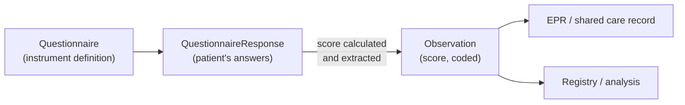

<b>Proof of concept.</b> This implementation guide is a demonstration only. It is
<b>not</b> an authoritative source, is not endorsed by NHS England, the National
Disease Registration Service or HL7, and must not be used for implementation or
clinical purposes. The authoritative source for COSD Pathology is the
<a href="https://nhsd-proxy.openprescribing.net/ndrs/data/data-sets/cosd/cosd-pathology-user-guide-v5.0/core---pathology">COSD Pathology User Guide</a>.

Patient-reported outcome measures (PROMs) are **outside the scope of the Cancer
Pathology Report model**: they contain no pathology content. This page records how
they fit the [Cancer Pathway](CancerPathway.html), which instruments are used in
England, and how they are defined in terminologies and FHIR. Its layout follows the
German Medical Informatics Initiative
[PRO implementation guide](https://build.fhir.org/ig/medizininformatik-initiative/kerndatensatzmodul-proms/en/index.html).

### References

- [Cancer Quality of Life Survey](https://nhsd-proxy.openprescribing.net/ndrs/data/data-outputs/cancer-data-hub/cancer-quality-of-life-survey) - NHS England and NDRS ([first data release summary](https://england.nhs.uk/wp-content/uploads/2021/11/Cancer-quality-of-life-survey-summary-report-first-data-release.pdf))
- [MII PRO implementation guide](https://build.fhir.org/ig/medizininformatik-initiative/kerndatensatzmodul-proms/en/index.html) - Medizininformatik-Initiative (Germany), FHIR R4 with Structured Data Capture (SDC); its [scoring](https://build.fhir.org/ig/medizininformatik-initiative/kerndatensatzmodul-proms/en/scoring.html), [EQ-5D-5L](https://build.fhir.org/ig/medizininformatik-initiative/kerndatensatzmodul-proms/en/eq-5d-5l.html) and [EORTC QLQ-C30](https://build.fhir.org/ig/medizininformatik-initiative/kerndatensatzmodul-proms/en/eortc-qlq-c30.html) pages
- [Gravitate Health - EQ-5D-5L Questionnaire](https://build.fhir.org/ig/hl7-eu/gravitate-health-ips/Questionnaire-Questionnaire-EQ5D-5L.html) - HL7 Europe
- [HL7 FHIR Structured Data Capture (SDC)](https://hl7.org/fhir/uv/sdc/) - Questionnaire rendering, calculation and extraction to Observation
- [Mapping PRO questionnaires to SNOMED CT and LOINC](https://medinform.jmir.org/2023/1/e49301) - JMIR Medical Informatics, 2023
- [EuroQol](https://euroqol.org/) and [EORTC Quality of Life Group](https://qol.eortc.org/) - the instrument owners

### Overview

PROMs are not a single step at the end of the pathway:

| Kind | Who collects | When | Link to pathology |
|---|---|---|---|
| **National PROMs** - the [Cancer Quality of Life Survey](https://nhsd-proxy.openprescribing.net/ndrs/data/data-outputs/cancer-data-hub/cancer-quality-of-life-survey) | NHS England with NDRS | About **18 months after diagnosis**; EQ-5D and EORTC QLQ-C30 | Patients are identified from cancer registration data and results are analysed by tumour site and stage. The Cancer Pathology Report's diagnosis details (diagnosis date, site, morphology, stage) reach PROMs **through the registry**, not through any exchange in this guide |
| **Clinical PROMs** | The care team | During and after treatment - symptoms, toxicity, quality of life; in follow-up alongside Holistic Needs Assessments and symptom diaries - see [Cancer Monitoring](CancerMonitoring.html#patient-reported-outcomes-during-follow-up) | None directly; an exchange between the patient and the care team |
{:.grid}

In FHIR, an instrument is a `Questionnaire`; a patient's answers are a
`QuestionnaireResponse`; scores (and, where useful, individual answers) are
extracted as `Observation`s so they can be trended and queried like any other
result.

### PRO Library

Instruments used by the national survey. Codes checked on tx.fhir.org on
2026-11-21 (SNOMED CT UK edition 20261021); neither instrument has LOINC codes.

| Instrument | Measures | SNOMED CT (UK edition) | LOINC | FHIR Questionnaire | Licence |
|---|---|---|---|---|---|
| [EQ-5D-5L](#eq-5d-5l) | Generic health-related quality of life | Instrument, assessment, each dimension score, index value and VAS | None | MII (production ready), HL7 Europe Gravitate Health | EuroQol - registration required |
| [EORTC QLQ-C30](#eortc-qlq-c30) | Cancer-specific quality of life | `273446001` only - no item or scale codes | None | MII (technical preview) | EORTC - licence required before production use |
{:.grid}

No NHS England or UK Core Questionnaire was found for either instrument, and no
data specification for the Cancer Quality of Life Survey was checked -
**To confirm**.

### EQ-5D-5L

#### Clinical context

Five dimensions - mobility, self-care, usual activities, pain/discomfort,
anxiety/depression - each answered on five levels, plus a visual analogue scale
(EQ VAS, 0 to 100) for overall health today. Results are reported as a five-digit
health profile, a single **index value** derived from the profile using a
population value set, and the VAS. The EQ-5D-3L (three levels) is the earlier
version. Which value set is used for the index in England is **To confirm**.

#### Coding

| SNOMED CT | Display |
|---|---|
| `73041000052103` | EuroQoL five dimension five level questionnaire |
| `838671000000106` | Assessment using EuroQol five dimension self-report questionnaire |
| `821551000000108` | EuroQol five dimension five level mobility score |
| `821561000000106` | EuroQol five dimension five level self-care score |
| `821581000000102` | EuroQol five dimension five level usual activities score |
| `821591000000100` | EuroQol five dimension five level pain discomfort score |
| `821611000000108` | EuroQol five dimension five level anxiety depression score |
| `736534008` | EuroQol five dimension five level index value |
| `736535009` | EuroQol visual analogue score |
| `870621000000108` | EQ-5D (EuroQol five dimension) self-report questionnaire declined |
{:.grid}

These cover each dimension, the index and the VAS as `Observation.code`, so an
extracted EQ-5D-5L result can be fully coded with SNOMED CT.

#### FHIR

The MII guide splits EQ-5D-5L into Questionnaire **variants** from one base
definition: *minimal* (structure only), *displayable* (showing answers already
captured), and *collectable* (validation, required items and a hidden "no answer"
option). Answers use an MII code system with ordinal values, so they can be scored.
The Gravitate Health Questionnaire has the five dimensions and the VAS, each
dimension bound to its own value set.

#### Licence

EuroQol: per the MII guide, "available for non-commercial purposes after
registration without additional license fees". Commercial use, and reproducing the
question wording, need EuroQol's terms - **To confirm** for NHS use.

### EORTC QLQ-C30

#### Clinical context

The core cancer quality of life questionnaire (version 3.0): 30 items, scored into
15 scales. Items 1 to 28 use a 4-point scale and items 29 and 30 a 7-point scale;
each scale is linearly transformed to 0 to 100. Disease- and treatment-specific
modules (for example QLQ-BR23, breast) add to the core.

| Group | Scales |
|---|---|
| Global | Global health status / quality of life |
| Functional (5) | Physical, role, emotional, cognitive, social |
| Symptom (9) | Fatigue, nausea and vomiting, pain, dyspnoea, insomnia, appetite loss, constipation, diarrhoea, financial difficulties |
{:.grid}

#### Coding

Only the instrument itself is coded:

| SNOMED CT | Display |
|---|---|
| `273446001` | European Organisation for Research and Treatment of Cancer - Quality of Life questionnaire |
{:.grid}

There are no SNOMED CT or LOINC codes for the 30 items or the 15 scale scores, so
extracted scores need the EORTC's own identifiers or a local code system (the MII
guide defines its own). This is the main terminology gap for cancer PROMs.

#### FHIR

The MII guide has a QLQ-C30 v3.0 Questionnaire with all 30 items and 15 scale
scores (technical preview). Its scoring follows the EORTC scoring manual, including
the rule that a scale is scored if at least half its items are answered.

#### Licence

EORTC holds the copyright: "EORTC licensing is required before production use"
(MII guide). Question wording must not be reproduced here.

### Scoring

The MII guide separates three ways of producing a score, which apply equally here:

| Channel | Where the score is calculated | Example |
|---|---|---|
| Client-side | In the form renderer, with an SDC `calculatedExpression` (FHIRPath) | Simple sums |
| Server-side | A rules library (CQL) run against the QuestionnaireResponse; authoritative | EQ-5D-5L index (value set lookup), QLQ-C30 half-rule |
| External | Calculated elsewhere (survey supplier, analysis software) and supplied as an `Observation` only | A national survey returning scores |
{:.grid}

For external scores the MII guide creates only the Observation and "never
modifies the QuestionnaireResponse". The national survey is likely to be external
in this sense - **To confirm**.

### Gaps

- No NHS England FHIR Questionnaire or data specification found for the Cancer
  Quality of Life Survey.
- EORTC QLQ-C30 items and scales have no SNOMED CT or LOINC codes.
- Both instruments are licensed, so this guide cannot publish their question
  wording; a Questionnaire here could only reference them.
- **Open** whether clinical PROMs should be in scope of a cancer pathway guide at
  all, or of a separate one.
