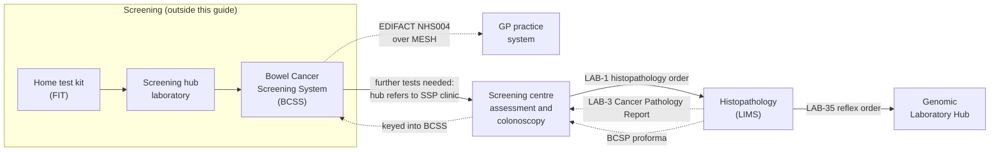

<div class="alert alert-danger" role="alert">
<b>Proof of concept.</b> This implementation guide is a demonstration only. It is
<b>not</b> an authoritative source, is not endorsed by NHS England, the National
Disease Registration Service or HL7, and must not be used for implementation or
clinical purposes. The authoritative sources are the standards each page references -
for example the <a href="https://nhsd-proxy.openprescribing.net/ndrs/data/data-sets/cosd/cosd-pathology-user-guide-v5.0/core---pathology">COSD Pathology User Guide</a>
or <a href="https://standards.nhs.uk/published-standards/palliative-care-coordination-core-content">SCCI1580</a>.
</div>

A positive screening result is one of the ways a patient enters the
[Cancer Pathway](CancerPathway.html#pathway-stages). This page covers how screening
results are exchanged today, using bowel cancer screening as the example, and where
screening meets the cancer pathology report.

### References

- [Bowel Cancer Screening - EDIFACT](https://digital.nhs.uk/developer/api-catalogue/bowel-cancer-screening-edifact) - NHS England API catalogue (checked 2026-11-21; page last edited 16 April 2026)
- [Lab Results adaptor](https://digital.nhs.uk/developer/api-catalogue/lab-results-adaptor) - NHS England API catalogue (checked 2026-11-21; page last edited 6 March 2025), source on [GitHub](https://github.com/nhsconnect/integration-adaptor-lab-results)
- [Pathology Messaging - EDIFACT](https://digital.nhs.uk/developer/api-catalogue/pathology-messaging-edifact) - the related pathology results integration to GP practices
- [Message Exchange for Social Care and Health (MESH) API](https://digital.nhs.uk/developer/api-catalogue/message-exchange-for-social-care-and-health-api)
- [Bowel cancer screening services](https://digital.nhs.uk/services/screening-services/bowel-cancer-screening-services) - NHS England
- [Pathology FHIR Implementation Guide](https://simplifier.net/guide/pathology-fhir-implementation-guide) - NHS England, reports from pathology laboratories to primary care, replacing PMIP EDIFACT
- [Electronic GP Communications Requirements for GPSoC Software Suppliers](https://digital.nhs.uk/binaries/content/assets/website-assets/developer/bowel-cancer-screening---edifact-api/cancer-screening---egp-comms-gp-software-supplier-requirements-v4.1.doc) - v4.1 draft, 24 November 2014, the NHS004 specification (Word document, linked from the Bowel Cancer Screening EDIFACT page)
- [Bowel cancer screening: pathway requirements specification](https://www.gov.uk/government/publications/bowel-cancer-screening-pathway-requirements-specification/bowel-cancer-screening-pathway-requirements-specification) - GOV.UK (updated 6 March 2026)
- [Bowel cancer screening: guidance on reporting lesions](https://www.gov.uk/government/publications/bowel-cancer-screening-reporting-lesions/bowel-cancer-screening-guidance-on-reporting-lesions) - GOV.UK (updated 4 October 2024)
- [Bowel cancer screening programme standards](https://www.gov.uk/government/publications/bowel-cancer-screening-programme-standards/bowel-cancer-screening-programme-standards-reporting-from-1-april-2025) - GOV.UK, reporting from 1 April 2025
- [Pathology to Genomics Reflex](https://github.com/nw-gmsa/nw-gmsa-use-cases/blob/main/PathologyToGenomicsReflex.md) - NW GMSA use case

### Overview

England runs national screening programmes for bowel, breast and cervical cancer,
and is rolling out lung cancer screening. Each programme has its own national
screening IT system, which manages invitations (call and recall) and records
results. A screening test is therefore ordered by the **programme**, not by a
clinician using order comms, and the result is sent to the patient's **GP** for
information.

If the screening test is positive the patient is referred for diagnostic tests.
From there the pathway is the same as for any suspected cancer: a biopsy or
resection is sent to histopathology ([LAB-1](LAB-1.html)), and the
[Cancer Pathology Report](StructureDefinition-CancerPathologyComposition.html) goes back to the requester
([LAB-3](LAB-3.html)) and, if needed, on to genomics ([LAB-35](LAB-35.html)).



Solid lines are orders and referrals; dashed lines are results and reports.

### Bowel Cancer Screening Results to GP Practices

The NHS England
[Bowel Cancer Screening - EDIFACT](https://digital.nhs.uk/developer/api-catalogue/bowel-cancer-screening-edifact)
integration sends screening test results from the screening system to GP practice
systems:

> "Use this messaging integration to receive bowel cancer screening test results in
> primary care GP systems from the screening system, specifically faecal occult
> blood test (FOBT) results."

| Item | Detail |
|---|---|
| Direction | Screening system to GP practice system |
| Content | One coded screening result - see [FIT Result](#fit-result) |
| Message | UN/EDIFACT **NHS004** - "a simpler version of the NHS003 messages specified in the Pathology EDIFACT v1.003 Standard", "with a single SNOMED code and 5 result values" |
| Transport | MESH, workflow ID `SCRN_BCS_MEDRPT_V4` |
| Interactions | ISB 1557 EDIFACT Pathology Messaging, with the changes in the *Electronic GP Communication Requirements for GPSoC Software Suppliers* (draft v4.1) |
| Status | In production |
{:.grid}

The API page refers to "the screening system"; the NHS004 specification says "All
messages sent from BCS are sent from a single trading partner", addressed to the
GP practice (by its practice code) rather than to a named GP.

#### Lab Results adaptor

The [Lab Results adaptor](https://digital.nhs.uk/developer/api-catalogue/lab-results-adaptor)
is a self-hosted component for **receiving** systems (typically GP systems):

> "The adaptor downloads EDIFACT laboratory results from MESH, translates them into
> FHIR (DSTU3) format and puts them on the Outbound GP Queue (AMQP 1.0 protocol)."

| Item | Detail |
|---|---|
| Input | EDIFACT pathology (NHS003) and bowel cancer screening (NHS004) results from MESH |
| Output | FHIR **DSTU3**, on an AMQP 1.0 queue |
| Deployment | Docker image, with AWS and Azure Terraform examples |
| Status | Beta (private beta), v0.0.6 |
{:.grid}

The adaptor is an example of the pattern described on the
[Cancer Pathway](CancerPathway.html) page: FHIR created by converting an existing
message. Any gap in the source message (here a single SNOMED CT code and five
result values) carries straight into the FHIR. The output is FHIR DSTU3, not the
R4 used by the NHS England Pathology FHIR IG, HL7 Europe Laboratory Report or this
guide.

### FIT Result

The programme tests a home faecal immunochemical test (FIT) kit for blood. Kits
are "sent out by post from regional programme hubs", which also test them
([pathway requirements](https://www.gov.uk/government/publications/bowel-cancer-screening-pathway-requirements-specification/bowel-cancer-screening-pathway-requirements-specification)).
The analyser measures faecal haemoglobin as a number, but the **screening result is
a category**: the kit is positive when "blood is detected in the sample at a level
on or above the screening threshold". The programme standards list the results as
"'spoilt' and 'technical fail' results, as well as the more expected results of:
'no further tests are needed' or 'further tests are needed'".

So the result is a discrete, coded result - an `OBX` (or FHIR `Observation`) whose
answer is one of a small set of codes - not a numeric value. The threshold has
been 120 µg Hb/g faeces since FIT was introduced in 2019, and is being lowered to
80 µg Hb/g in a phased rollout due to complete by March 2028; the UK National
Screening Committee recommends 20 µg Hb/g as the optimum
([UK NSC blog, January 2026](https://nationalscreening.blog.gov.uk/2026/01/26/more-sensitive-bowel-cancer-screening-test-implemented-in-line-with-uk-nsc-recommendation),
[Cancer Research UK](https://news.cancerresearchuk.org/2026/01/26/nhs-england-increasing-bowel-cancer-screening-fit-test-sensitivity/)).

The difference is between a **programme outcome** and a **laboratory result**,
not between England and elsewhere. The hub laboratory does measure faecal
haemoglobin; BCSS turns the value into a programme category, and only the category
is sent to the GP. A programme code such as *FOB test abnormal* means "at or above
this programme's threshold at the time" - a threshold that is now changing. A value
with a reference range carries its own threshold and can be reinterpreted later.
Symptomatic FIT in England is reported as a value (see
[below](#screening-fit-and-symptomatic-fit)), and qualitative results are common
elsewhere (e.g. LOINC `29771-3` positive or negative in the US). What other
European programmes send to primary care has not been checked.

#### NHS004 codes (2014 specification)

The NHS004 specification predates FIT and codes the result as a faecal occult blood
(FOB) result. The investigation is `368481000000103` *Bowel cancer screening
programme: faecal occult blood result*, and the result value is one of five codes:

| SNOMED CT | Display (UK edition) | Read v2 |
|---|---|---|
| `375211000000108` | Bowel cancer screening programme faecal occult blood test normal | `686A.` |
| `375241000000109` | Bowel cancer screening programme faecal occult blood test abnormal | `686B.` |
| `375121000000106` | Bowel cancer screening programme faecal occult blood testing kit spoilt | `6867.` |
| `384241000000100` | Bowel cancer screening programme faecal occult blood testing incomplete participation | `686C.` |
| `373251000000108` | No response to bowel cancer screening programme invitation | `9Ow2.` |
{:.grid}

The specification carries no measurement value or threshold, and says the codes
should be held as a local list so that "further codes" can be added. It also adds
bowel scope (flexible sigmoidoscopy) result codes (v3.0, 2013).

#### FIT codes

SNOMED CT UK edition has FIT-specific concepts, which are not in the 2014
specification:

| SNOMED CT | Display (UK edition) | Use |
|---|---|---|
| `1101361000000103` | Bowel cancer screening programme liquid faecal immunochemical test normal | Result (finding) |
| `1101371000000105` | Bowel cancer screening programme liquid faecal immunochemical test abnormal | Result (finding) |
| `1101381000000107` | Bowel cancer screening programme liquid faecal immunochemical test technical failure | Result (finding) |
| `1101391000000109` | Bowel cancer screening programme liquid faecal immunochemical test sample rejected | Result (finding) |
| `1101401000000107` | No response to bowel cancer screening programme liquid faecal immunochemical testing invitation | Result (finding) |
| `1049361000000101` | Quantitative faecal immunochemical test | Observable (child of *Screening test observable*) - the question for a numeric result |
{:.grid}

Whether BCSS now sends these FIT codes in NHS004, instead of the FOB codes, is
**To confirm**.

LOINC has no screening-programme result codes, but has codes for the test itself:

| LOINC | Display | Fit with FIT |
|---|---|---|
| `29771-3` | Hemoglobin [Presence] in Stool from gastrointestinal lower by Immunoassay | Qualitative (positive or negative) result |
| `58453-2` | Hemoglobin [Mass/volume] in Stool from gastrointestinal lower by Immunoassay | Quantitative, but per volume (of sample buffer); FIT is reported per mass of faeces (µg Hb/g) |
| `27396-1` | Hemoglobin [Mass/mass] in Stool from gastrointestinal | Mass per mass (example units ng/g), but no method - the closest fit for a quantitative FIT result |
| `57803-9` | Occult blood panel - Stool by Immunoassay | Panel of qualitative results over several samples (US practice) |
| `77354-9`, `77353-1` | Noninvasive colorectal cancer DNA and occult blood screening [Presence] / [Interpretation] in Stool | Multitarget stool DNA plus FIT (US practice); not used in the English programme |
{:.grid}

No LOINC code exactly matches a quantitative FIT result by immunoassay in µg Hb/g.
SNOMED CT and LOINC codes checked on tx.fhir.org on 2026-11-21 (SNOMED CT UK
edition 20261021).

#### More detailed FIT result

The screening result is often described as basic. No code gives a more detailed
result: the detail would come from sending the **measurement and its context**
alongside the category. The World Endoscopy Organization
[FIT for Screening expert working group](https://worldendo.org/about-us/committees/colorectal-cancer-screening-committee/expert-working-groups/fit-for-screening/fit-for-screening-expert-working-group-discussion-documents)
recommends reporting faecal haemoglobin concentration in **µg Hb/g faeces**,
because sampling devices collect different masses of faeces into different buffer
volumes, so the analyser's ng/mL reading is not comparable between devices. The
[FITTER standard and checklist](https://researchnow.flinders.edu.au/en/publications/improving-the-reporting-of-evaluations-of-faecal-immunochemical-t/)
(Fraser et al., 2015) lists what an evaluation of FIT should report; it is a
checklist for studies, not a message standard, but is a guide to the context a
result needs.

A proposal (indicative HL7 v2; not an agreed standard):

| Item | HL7 v2 | Example |
|---|---|---|
| Faecal haemoglobin concentration | `OBX-2` `NM`, `OBX-3` `27396-1^Hemoglobin [Mass/mass] in Stool from gastrointestinal^LN^1049361000000101^Quantitative faecal immunochemical test^SCT`, `OBX-5` value, `OBX-6` `ug/g^^UCUM` | `100` |
| Result outside the measuring range | `OBX-2` `SN`, e.g. `<^7` | Below the limit of quantitation |
| Threshold applied | `OBX-7` reference range | `<80` |
| Abnormal flag | `OBX-8` | `A` |
| Analyser and sampling device | `OBX-18` equipment instance identifier, or `OBX-17` method | **To confirm** |
| Programme category | A second `OBX`, coded result as above | `1101371000000105` abnormal |
{:.grid}

Why it matters:

- **The threshold is changing.** During the 120 to 80 µg Hb/g rollout, "normal"
  means different things in different areas: 100 µg Hb/g is normal at 120 and
  abnormal at 80. A category cannot be reinterpreted later; a value can.
- **Symptomatic FIT uses the same measurement** (see below), so values would let a
  patient's screening and symptomatic results be compared.
- **NHS004 could carry it.** The specification's result segment has optional
  measurement value and unit elements, but does not use them.

#### Example: FIT Screening Result (HL7 v2 ORU_R01)

Fictitious, and an **assumption** to be confirmed: that the hub laboratory's LIMS
reports the FIT as an HL7 v2 `ORU^R01`, which is then converted into the NHS004
EDIFACT message to the GP practice. The NHS004 specification says all messages
come from "BCS" as a single trading partner, so the conversion is assumed to happen
in, or after, BCSS. `HUB01` (hub laboratory) is a placeholder, not an ODS code. The
patient is the NW Genomics test patient MANCHESTER, Sansa (NHS `973 738 3192`, on the
NHS England PDS INT environment), with her registered GP practice, Ancoats Urban
Village Medical Practice (`P84673`).
The analyser is illustrative - **To confirm**.

```
MSH|^~\&|LIMS|HUB01|BCSS|BCSS|20251104101500+0000||ORU^R01^ORU_R01|urn:uuid:5b0e7c2a-1f4d-4a8e-9c3b-7d2e6f1a9b40|T|2.5.1|||AL
PID|1||9737383192^^^NHS^NH||MANCHESTER^Sansa^^^^^L||19720921|F|||Oxford Rd^^MANCHESTER^^M13 9PL
PD1|||ANCOATS URBAN VILLAGE MEDICAL PRACTICE^^P84673^^^ODS
ORC|RE|BCS25-0438812^BCSS|F25-118204^HUB01||CM||||20251104101500+0000|||^BCSP Hub Manager
OBR|1|BCS25-0438812^BCSS|F25-118204^HUB01|FITSCR^Bowel cancer screening faecal immunochemical test^HUB01|||20251029|||||||||^BCSP Hub Manager||||||20251104101500+0000|||F|||P84673^ANCOATS URBAN VILLAGE MEDICAL PRACTICE
OBX|1|NM|27396-1^Hemoglobin [Mass/mass] in Stool from gastrointestinal^LN^1049361000000101^Quantitative faecal immunochemical test^SNM3||142|ug/g^microgram per gram^UCUM|<120|H|||F|||20251103|||IMMUNOASSAY|HM-JACKarc-02^^HUB01
OBX|2|CWE|29771-3^Hemoglobin [Presence] in Stool from gastrointestinal lower by Immunoassay^LN||LA6576-8^Positive^LN||||||F|||20251103
OBX|3|CWE|368481000000103^Bowel cancer screening programme: faecal occult blood result^SNM3||1101371000000105^Bowel cancer screening programme liquid faecal immunochemical test abnormal^SNM3||||||F|||20251104
NTE|1||Further tests needed. Referred to specialist screening practitioner clinic.
SPM|1|F25-118204-K1&HUB01||119339001^Stool specimen^SNM3|||||||||||||20251029|20251031101500+0000
```

A normal result below the analyser's measuring range would use a structured
numeric (`SN`) value, with no abnormal flag:

```
OBX|1|SN|27396-1^Hemoglobin [Mass/mass] in Stool from gastrointestinal^LN^1049361000000101^Quantitative faecal immunochemical test^SNM3||<^7|ug/g^microgram per gram^UCUM|<120|N|||F|||20251103
OBX|2|CWE|29771-3^Hemoglobin [Presence] in Stool from gastrointestinal lower by Immunoassay^LN||LA6577-6^Negative^LN||||||F|||20251103
OBX|3|CWE|368481000000103^Bowel cancer screening programme: faecal occult blood result^SNM3||1101361000000103^Bowel cancer screening programme liquid faecal immunochemical test normal^SNM3||||||F|||20251104
```

| Segment | Content | Notes |
|---|---|---|
| `ORC-2` / `OBR-2` | Placer number `BCS25-0438812^BCSS` | The programme (BCSS) is the placer - it sent the kit. Assigning authority for BCSS **To confirm** (no ODS code identified) |
| `ORC-3` / `OBR-3` | Filler number `F25-118204^HUB01` | Hub laboratory accession number |
| `OBR-4` | Local `FITSCR` | No national order code; LOINC `57803-9` Occult blood panel - Stool by Immunoassay is a US multi-sample panel, so not used |
| `OBR-28` | GP practice | Result copy recipient - the NHS004 recipient (`ReceivingGPPracticeCode`). `OBR-28` is a person (`XCN`); putting the practice code in it is indicative |
| `OBX-1` | Faecal haemoglobin, LOINC `27396-1` with SNOMED CT `1049361000000101` | `OBX-5` value, `OBX-6` µg/g, `OBX-7` the threshold applied (`<120`), `OBX-8` flag, `OBX-17` method, `OBX-18` analyser |
| `OBX-2` | Presence, LOINC `29771-3` | Positive or negative against the threshold |
| `OBX-3` | Programme outcome, SNOMED CT | The only result NHS004 carries. Whether the LIMS or BCSS assigns it is **To confirm**; the FOB investigation code is used because no FIT equivalent was found |
| `SPM` | Kit sample, `119339001` Stool specimen | `SPM-17` sample date (from the kit), `SPM-18` received |
{:.grid}

Converting to NHS004 keeps the patient (`PID`), the GP practice (`PD1-3` /
`OBR-28`) and `OBX-3`. The value, threshold, flag and analyser (`OBX-1`, `OBX-2`)
have nowhere to go, because the specification does not use the result segment's
measurement elements: the detail exists in the ORU, and is lost in the conversion.

#### Screening FIT and symptomatic FIT

FIT is also ordered by GPs for patients **with symptoms**, to decide whether to
refer them on an urgent suspected cancer pathway. That is a normal laboratory
order and result (GP order comms, reported to the GP by pathology messaging), and
the result is the **quantitative** value, commonly against a 10 µg Hb/g threshold
(not checked against NICE guidance). The two should not be confused: a screening
result is a programme category, a symptomatic result is a measurement.
How symptomatic FIT is coded in pathology messages to GPs is **To confirm**.

### Who Orders the Histopathology?

**Not the GP, and not centrally.** The GP is not involved in ordering at any step
of the screening pathway:

| Step | Who | Source |
|---|---|---|
| FIT kit sent and tested | Regional programme hub | Pathway requirements: "sent out by post from regional programme hubs" |
| Referral after a positive result | The hub refers "individuals with a test result of 'further tests needed' for a specialist screening practitioner (SSP) clinic appointment" | Pathway requirements |
| Assessment and colonoscopy | Local screening centre: SSP clinic, then colonoscopy by "screening accredited colonoscopists" | Pathway requirements |
| Histopathology request | The **responsible endoscopist** at the screening centre. The request must show "that the specimen has resulted from BCSP endoscopy and must therefore be reported by a BCSP pathologist", with the number and sites of lesions, lesion sizes and any suspicion of malignancy | [Guidance on reporting lesions](https://www.gov.uk/government/publications/bowel-cancer-screening-reporting-lesions/bowel-cancer-screening-guidance-on-reporting-lesions), section 1.4 |
| Histopathology report | A BCSP-accredited pathologist at the local department, reported to RCPath datasets and BCSP guidance, within 7 days (standard BCSP-S09) | Guidance on reporting lesions; programme standards |
| Results into BCSS | Reporters "complete either the screening programme proforma or its computerised version ... These should be returned to the screening centre who will enter the pathology data onto the central bowel cancer screening system (BCSS)" | Guidance on reporting lesions, section 1.2 |
{:.grid}

In [LTW](LTW.html) terms the **screening centre endoscopy service** is the Order
Placer for the histopathology order ([LAB-1](LAB-1.html)), exactly as for a
symptomatic colonoscopy, and gets the report back ([LAB-3](LAB-3.html)). BCSS is
not an Order Placer and gets no electronic result: the BCSP polyp dataset is keyed
in by screening centre staff.

### Where Screening Meets the Cancer Pathology Report

| Step | Exchange | Standard today | In this guide |
|---|---|---|---|
| Screening test result to GP | Bowel screening system to GP practice | EDIFACT NHS004 over MESH; optionally converted to FHIR DSTU3 by the Lab Results adaptor | Out of scope - not a cancer pathology report |
| Referral after a positive result | Hub to screening centre SSP clinic, then colonoscopy | Within BCSS | Context - pathway entry point |
| Biopsy or polypectomy to histopathology | Screening centre endoscopist (Order Placer) to histopathology (Order Filler) | HL7 v2 `OML_O21` / order comms | [LAB-1](LAB-1.html) |
| Histopathology report | Histopathology to the requester | HL7 v2 `ORU_R01` | [LAB-3](LAB-3.html) - the [Cancer Pathology Report](StructureDefinition-CancerPathologyComposition.html) when cancer is found |
| Histopathology result to the screening programme | Pathologist to screening centre, keyed into BCSS | BCSP proforma (paper or "computerised version"), not a message | Out of scope today; BCSS could be a LAB-3 result copy recipient |
| Report to GP | Histopathology to GP practice | EDIFACT NHS003 (PMIP), moving to the NHS England Pathology FHIR IG | Possible additional LAB-3 recipient |
| Reflex genomic test (e.g. MMR deficient) | Histopathology to the Genomic Laboratory Hub | HL7 v2 `OML_O21` | [LAB-35](LAB-35.html) |
{:.grid}

Most screening-detected specimens are polyps, not cancers. Only a report with a
registrable cancer diagnosis is a COSD Cancer Pathology Report; other screening
histology (for example adenomas) is out of scope of the model.

#### Lynch syndrome surveillance

People with Lynch syndrome - the outcome being tested for in the
[worked example](index.html#worked-example-lynch-syndrome) - are surveilled by the
NHS Bowel Cancer Screening Programme: "The programme offers a colonoscopy every 2
years to people diagnosed with Lynch syndrome", and hubs "must also have systems in
place to invite the eligible cohort"
([pathway requirements](https://www.gov.uk/government/publications/bowel-cancer-screening-pathway-requirements-specification/bowel-cancer-screening-pathway-requirements-specification)).
Lynch syndrome surveillance colonoscopy is listed as a source of samples in the
pathology turnaround standard (BCSP-S09). So the genomic result in step ④ of the
worked example leads back into the screening programme - a link that today depends
on someone referring the patient. When the programme started this is not stated in
the pages checked.

### Other Screening Programmes

Not yet analysed. Each has its own screening system and laboratory or imaging
workflow, and each can lead to a cancer pathology report.

| Programme | Screening test | Leads to a cancer pathology report via |
|---|---|---|
| Bowel | FIT at home, then colonoscopy | Colonoscopic biopsy or polypectomy (above) |
| Breast | Mammography | Assessment clinic core biopsy - see [Imaging and Radiology](Imaging.html) |
| Cervical | HPV test, with cytology if HPV positive | Colposcopy biopsy |
| Lung | Low-dose CT | Image-guided biopsy or bronchoscopy - see [Imaging and Radiology](Imaging.html) |
{:.grid}

Screening systems and result flows for breast, cervical and lung screening are
**To confirm**.

### Gaps

- No national standard found for sending histopathology results from a LIMS to a
  screening system: BCSS pathology data is keyed in from a proforma.
- The NHS004 specification (2014) codes FOB results; FIT-specific SNOMED CT result
  codes exist, but whether they are used is **To confirm**. No LOINC code matches a
  quantitative FIT result in µg Hb/g.
- **Open** whether the hub LIMS sends an HL7 v2 `ORU^R01` that is converted to
  NHS004 (as assumed in the [example](#example-fit-screening-result-hl7-v2-oru_r01)).
- Screening results to GPs carry the category only, not the faecal haemoglobin
  concentration - see [More detailed FIT result](#more-detailed-fit-result).
- Screening results to GP practices use EDIFACT (NHS004). No FHIR R4 equivalent was
  found for screening results; the Lab Results adaptor converts to DSTU3.
- **Open** whether the screening system is an Order Placer, a result copy
  recipient, or neither, in [LTW](LTW.html) terms.
