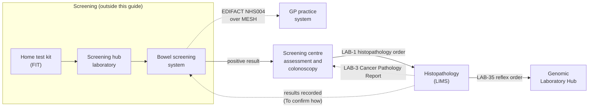

<b>Proof of concept.</b> This implementation guide is a demonstration only. It is
<b>not</b> an authoritative source, is not endorsed by NHS England, the National
Disease Registration Service or HL7, and must not be used for implementation or
clinical purposes. The authoritative source for COSD Pathology is the
<a href="https://nhsd-proxy.openprescribing.net/ndrs/data/data-sets/cosd/cosd-pathology-user-guide-v5.0/core---pathology">COSD Pathology User Guide</a>.

A positive screening result is one of the ways a patient enters the
[Cancer Pathway](CancerPathway.html#pathway-stages). This page covers how screening
results are exchanged today, using bowel cancer screening as the example, and where
screening meets the cancer pathology report.

### References

- [Bowel Cancer Screening - EDIFACT](https://digital.nhs.uk/developer/api-catalogue/bowel-cancer-screening-edifact) - NHS England API catalogue (checked 2026-11-21; page last edited 16 April 2026)
- [Lab Results adaptor](https://digital.nhs.uk/developer/api-catalogue/lab-results-adaptor) - NHS England API catalogue (checked 2026-11-21; page last edited 6 March 2025), source on [GitHub](https://github.com/nhsconnect/integration-adaptor-lab-results)
- [Pathology Messaging - EDIFACT](https://digital.nhs.uk/developer/api-catalogue/pathology-messaging-edifact) - the related pathology results integration to GP practices
- [Message Exchange for Social Care and Health (MESH) API](https://digital.nhs.uk/developer/api-catalogue/message-exchange-for-social-care-and-health-api)
- [Bowel cancer screening services](https://digital.nhs.uk/services/screening-services/bowel-cancer-screening-services) - NHS England
- [Pathology FHIR Implementation Guide](https://simplifier.net/guide/pathology-fhir-implementation-guide) - NHS England, reports from pathology laboratories to primary care, replacing PMIP EDIFACT
- [Pathology to Genomics Reflex](https://github.com/nw-gmsa/nw-gmsa-use-cases/blob/main/PathologyToGenomicsReflex.md) - NW GMSA use case

### Overview

England runs national screening programmes for bowel, breast and cervical cancer,
and is rolling out lung cancer screening. Each programme has its own national
screening IT system, which manages invitations (call and recall) and records
results. A screening test is therefore ordered by the **programme**, not by a
clinician using order comms, and the result is sent to the patient's **GP** for
information.

If the screening test is positive the patient is referred for diagnostic tests.
From there the pathway is the same as for any suspected cancer: a biopsy or
resection is sent to histopathology ([LAB-1](LAB-1.html)), and the
[Cancer Pathology Report](PathologyReport.html) goes back to the requester
([LAB-3](LAB-3.html)) and, if needed, on to genomics ([LAB-35](LAB-35.html)).

Solid lines are orders and referrals; dashed lines are results and reports.

### Bowel Cancer Screening Results to GP Practices

The NHS England
[Bowel Cancer Screening - EDIFACT](https://digital.nhs.uk/developer/api-catalogue/bowel-cancer-screening-edifact)
integration sends screening test results from the screening system to GP practice
systems:

> "Use this messaging integration to receive bowel cancer screening test results in
> primary care GP systems from the screening system, specifically faecal occult
> blood test (FOBT) results."

| Item | Detail |
|---|---|
| Direction | Screening system to GP practice system |
| Content | Faecal occult blood test result. The programme in England uses the faecal immunochemical test (FIT), a type of FOBT. Whether NHS004 carries FIT results unchanged is **To confirm** |
| Message | UN/EDIFACT **NHS004** - "a simpler version of the NHS003 messages specified in the Pathology EDIFACT v1.003 Standard", "with a single SNOMED code and 5 result values" |
| Transport | MESH, workflow ID `SCRN_BCS_MEDRPT_V4` |
| Interactions | ISB 1557 EDIFACT Pathology Messaging, with the changes in the *Electronic GP Communication Requirements for GPSoC Software Suppliers* (draft v4.1) |
| Status | In production |
{:.grid}

The API page refers to "the screening system" without naming it; it is presumably
the Bowel Cancer Screening System (BCSS) - **To confirm**.

#### Lab Results adaptor

The [Lab Results adaptor](https://digital.nhs.uk/developer/api-catalogue/lab-results-adaptor)
is a self-hosted component for **receiving** systems (typically GP systems):

> "The adaptor downloads EDIFACT laboratory results from MESH, translates them into
> FHIR (DSTU3) format and puts them on the Outbound GP Queue (AMQP 1.0 protocol)."

| Item | Detail |
|---|---|
| Input | EDIFACT pathology (NHS003) and bowel cancer screening (NHS004) results from MESH |
| Output | FHIR **DSTU3**, on an AMQP 1.0 queue |
| Deployment | Docker image, with AWS and Azure Terraform examples |
| Status | Beta (private beta), v0.0.6 |
{:.grid}

The adaptor is an example of the pattern described on the
[Cancer Pathway](CancerPathway.html) page: FHIR created by converting an existing
message. Any gap in the source message (here a single SNOMED CT code and five
result values) carries straight into the FHIR. The output is FHIR DSTU3, not the
R4 used by the NHS England Pathology FHIR IG, HL7 Europe Laboratory Report or this
guide.

### Where Screening Meets the Cancer Pathology Report

| Step | Exchange | Standard today | In this guide |
|---|---|---|---|
| Screening test result to GP | Bowel screening system to GP practice | EDIFACT NHS004 over MESH; optionally converted to FHIR DSTU3 by the Lab Results adaptor | Out of scope - not a cancer pathology report |
| Referral after a positive result | Screening programme to screening centre (assessment, colonoscopy) | Within the screening system - **To confirm** | Context - pathway entry point |
| Biopsy or polypectomy to histopathology | Endoscopy (Order Placer) to histopathology (Order Filler) | HL7 v2 `OML_O21` / order comms | [LAB-1](LAB-1.html) |
| Histopathology report | Histopathology to the requester | HL7 v2 `ORU_R01` | [LAB-3](LAB-3.html) - the [Cancer Pathology Report](PathologyReport.html) when cancer is found |
| Histopathology result to the screening programme | Histopathology or screening centre to the screening system | **To confirm** whether results are keyed into the screening system or sent electronically | Possible additional LAB-3 recipient (result copy) |
| Report to GP | Histopathology to GP practice | EDIFACT NHS003 (PMIP), moving to the NHS England Pathology FHIR IG | Possible additional LAB-3 recipient |
| Reflex genomic test (e.g. MMR deficient) | Histopathology to the Genomic Laboratory Hub | HL7 v2 `OML_O21` | [LAB-35](LAB-35.html) |
{:.grid}

Most screening-detected specimens are polyps, not cancers. Only a report with a
registrable cancer diagnosis is a COSD Cancer Pathology Report; other screening
histology (for example adenomas) is out of scope of the model.

#### Lynch syndrome surveillance

People with Lynch syndrome - the outcome being tested for in the
[worked example](index.html#worked-example-lynch-syndrome) - are offered regular
colonoscopic surveillance. Whether this is run through the NHS Bowel Cancer
Screening Programme, and so through the screening system above, is
**To confirm**.

### Other Screening Programmes

Not yet analysed. Each has its own screening system and laboratory or imaging
workflow, and each can lead to a cancer pathology report.

| Programme | Screening test | Leads to a cancer pathology report via |
|---|---|---|
| Bowel | FIT at home, then colonoscopy | Colonoscopic biopsy or polypectomy (above) |
| Breast | Mammography | Assessment clinic core biopsy - see [Imaging and Radiology](Imaging.html) |
| Cervical | HPV test, with cytology if HPV positive | Colposcopy biopsy |
| Lung | Low-dose CT | Image-guided biopsy or bronchoscopy - see [Imaging and Radiology](Imaging.html) |
{:.grid}

Screening systems and result flows for breast, cervical and lung screening are
**To confirm**.

### Gaps

- No national standard found for sending histopathology results from a LIMS to a
  screening system.
- Screening results to GP practices use EDIFACT (NHS004). No FHIR R4 equivalent was
  found for screening results; the Lab Results adaptor converts to DSTU3.
- **Open** whether the screening system is an Order Placer, a result copy
  recipient, or neither, in [LTW](LTW.html) terms.
