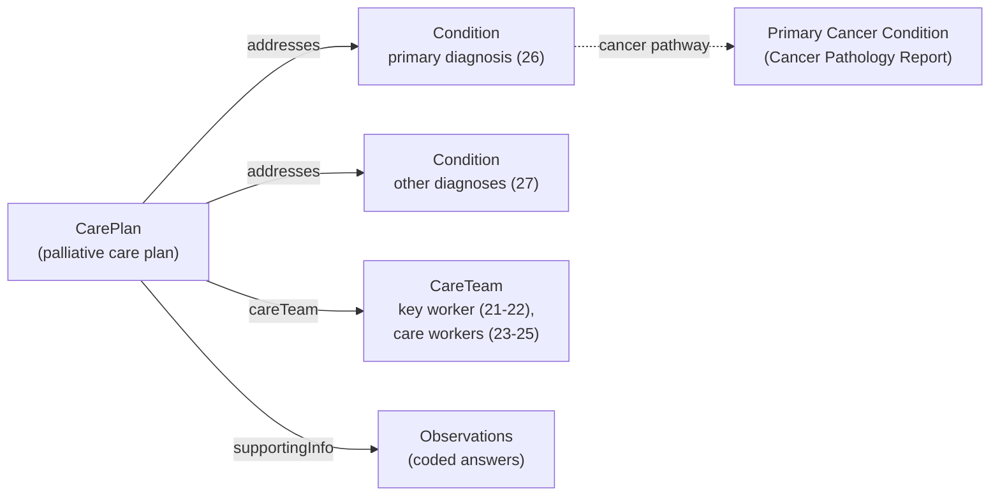

<b>Proof of concept.</b> This implementation guide is a demonstration only. It is
<b>not</b> an authoritative source, is not endorsed by NHS England, the National
Disease Registration Service or HL7, and must not be used for implementation or
clinical purposes. The authoritative sources are the standards each page references -
for example the <a href="https://nhsd-proxy.openprescribing.net/ndrs/data/data-sets/cosd/cosd-pathology-user-guide-v5.0/core---pathology">COSD Pathology User Guide</a>
or <a href="https://standards.nhs.uk/published-standards/palliative-care-coordination-core-content">SCCI1580</a>.

The record held by an electronic palliative care co-ordination system (EPaCCS),
based on **SCCI1580 Palliative Care Co-ordination: Core Content**. It is outside the
scope of the Cancer Pathology Report model - it has no pathology content - but
follows the same approach: a logical model, FHIR profiles, a FHIR Document and an
example rendering. How the record is used is described in Volume 1,
[Palliative and End of Life Care](EndOfLifeCare.html).

### Sources and Precedence

| Precedence | Source | Used for |
|---|---|---|
| 1 | [SCCI1580 Palliative Care Co-ordination: Core Content](https://standards.nhs.uk/published-standards/palliative-care-coordination-core-content) - Amd 11/2015, v4.0 ([requirements specification](https://digital.nhs.uk/binaries/content/assets/website-assets/isce/scci1580/1580112015spec.pdf), [corrigendum](https://digital.nhs.uk/binaries/content/assets/website-assets/isce/scci1580/1580112015corrigendum.pdf), January 2016) | **Primary source of requirements** - 16 sections, 60 data items, their data entry status and codes |
| 2 | [PRSB Palliative and End of Life Care Standard](https://theprsb.org/standards/palliativeandendoflifecare/) - build 11.0 | Only content SCCI1580 does not define: CPR decision involvement and review responsibility, mental capacity assessment, contingency plans, palliative care register, document locations |
| - | [FHIR End of Life API](https://webarchive.nationalarchives.gov.uk/ukgwa/20250306144031/https://developer.nhs.uk/apis/eol-alpha/index.html) - NHS Digital, alpha, FHIR STU3, 2019, and its [Questionnaire CareConnect-EOLC-1](https://gist.github.com/KevinMayfield/5b15657ab584a5326c2e5fd84e2a68b8) | A **mapping** only. It used the EoL National Minimum Dataset v2.2, not SCCI1580 v4.0 |
| - | [ReSPECT form](https://www.respectprocess.org.uk/) v3 - Resuscitation Council UK | **Presentation** only: the section order of the FHIR Document. The form is licensed CC BY-NC-ND 4.0, so only its section headings are used |
{:.grid}

### Artifacts

| Artifact | Role |
|---|---|
| [Palliative Care Record](StructureDefinition-PalliativeCareRecord.html) | Logical model: SCCI1580's 16 sections and 60 data items, plus PRSB items where SCCI1580 is silent. Mappings to SCCI1580, PRSB, the 2019 API and [openEHR](#openehr-archetypes) |
| [Palliative Care Record](Questionnaire-PalliativeCareRecordQuestionnaire.html) Questionnaire | SDC capture form. linkIds are the SCCI1580 item numbers; each item's `definition` points to the logical model; coded items are extracted as Observations |
| [SCCI1580 Data Item](CodeSystem-scci1580-data-item.html) code system | The 60 SCCI1580 data items, used as `Questionnaire.item.code` and `Observation.code` - a local proposal, as SCCI1580 publishes no code system |
| [Palliative Care Plan](StructureDefinition-PalliativeCarePlan.html) | Profile: the person's palliative care plan. `addresses` the diagnoses (SCCI1580 items 26-27) as Conditions, `careTeam` links to the care team, `supportingInfo` holds the Observations |
| [Palliative Care Team](StructureDefinition-PalliativeCareTeam.html) | Profile: the key worker (items 21-22) and care workers involved in care (items 23-25) |
| [Palliative Care Record Observation](StructureDefinition-PalliativeCareRecordObservation.html) | Profile for an extracted answer: `code` the SCCI1580 data item, `derivedFrom` the QuestionnaireResponse |
| [Palliative Care Record Composition](StructureDefinition-PalliativeCareRecordComposition.html) | Profile for the Document's Composition: type SNOMED CT `861421000000109` *End of Life Care Coordination Summary*, ordered sections in ReSPECT order ([section codes](CodeSystem-eol-document-section.html)) |
| [Palliative Care Record Scenario](ExampleScenario-PalliativeCareRecordScenario.html) | Example scenario: Task, capture, extraction, Document, print, retrieval and amendment |
{:.grid}

### Content

The [logical model](StructureDefinition-PalliativeCareRecord.html) follows
SCCI1580's sections. Items marked * are mandatory in SCCI1580.

| SCCI1580 section | Data items | Questionnaire | Extracted to |
|---|---|---|---|
| 1 Consent | 1 Consent status* | `s1` | Observation (and `Consent` - **Open**) |
| 2 Record | 2 Record creation date*, 4 Date and time of last amendment* | `s2` | Composition date |
| 3 Plan and requested actions | 3 Planned review date; 44-47 CPR decision, date, review date, document location; PRSB involvement and review responsibility | `s3` | Observations |
| 4 Person demographics | 5-13 Name*, preferred name, birth date*, NHS number* and status*, gender, address*, telephone; 16-17 main carer and availability of carer support* | `s4` | `Patient`, `RelatedPerson`; item 16 coded as an Observation |
| 5 Special requirements | 14 Interpreter, 15 Language, 29 Functional status, 28 Disability, 33 EoLC tool in use; PRSB palliative care register | `s5` | Observations |
| 6 Information and advice given | 18 Carer aware of prognosis, 48 Awareness of CPR decision | `s6` | Observations |
| 7 GP practice | 19 Usual GP name*, 20 Practice details* | `s7` | `Patient.generalPractitioner` |
| 8 Key worker | 21-22 | `s8` | `CareTeam.participant` (role key worker) |
| 9 Services and care | 23-25 Care workers and professional group | `s9` | `CareTeam.participant` (role professional group) |
| 10 Diagnoses | 26 Primary end of life care diagnosis*, 27 Other diagnoses, 34 Likely prognosis | `s10` | 26-27: `Condition`, addressed by the `CarePlan`; 34: Observation |
| 11 Allergies | 30 Allergies/adverse drug reactions | `s11` | Observation (`AllergyIntolerance` - **Open**) |
| 12 Medications and devices | 31 Anticipatory medicines/just in case box, 32 Location | `s12` | Observations |
| 13 Legal information | 35 Advance statement, 49-50 ADRT, 51-53 LPA for personal welfare; PRSB mental capacity assessment and document locations | `s13` | Observations, `RelatedPerson` |
| 14 Concerns, expectations and wishes | 36-43 Preferred place of death 1st and 2nd choice, 54-57 others to be involved in decisions, 58 Other issues or preferences; PRSB contingency plans | `s14` | Observations, `RelatedPerson` |
| 15-16 After death | 60 Actual place of death, 59 Date of death | `s15` | Observations |
{:.grid}

The record is persisted around an [Palliative Care Plan](StructureDefinition-PalliativeCarePlan.html):

For a person on the cancer pathway the primary end of life care diagnosis need not
be re-entered: the CarePlan can address the [Primary Cancer Condition](StructureDefinition-PrimaryCancerCondition.html)
already recorded from the Cancer Pathology Report, as in the [examples](#examples).

Each extracted Observation has `code` = the [SCCI1580 data item](CodeSystem-scci1580-data-item.html)
(for example `scci1580-data-item#44` CPR decision), `value` = the answer (for
example SNOMED CT `450476008` Not for cardiopulmonary resuscitation), and
`derivedFrom` = the QuestionnaireResponse.

### Towards Don't Repeat Yourself

Much of the record - demographics, GP, diagnoses, allergies, medicines, functional
status, advance directives - is already held elsewhere: in the Personal Demographics
Service, the GP record, the cancer pathway and, in future, the person's patient
summary in the NHS England Single Patient Record. Ideally the palliative care record
would **reference** that information rather than **repeat** it
([don't repeat yourself](https://en.wikipedia.org/wiki/Don%27t_repeat_yourself)).
That is not practical yet, so the guide takes steps that allow it later:

| Step | How | Where |
|---|---|---|
| Know which items are owned elsewhere | Each data item is marked *this record* or *held elsewhere*, with its source | Logical model, **Authoritative source** mapping |
| Populate rather than re-enter | The Questionnaire declares the patient as its SDC `launchContext`, and `initialExpression`s pre-fill demographics (5-13), GP practice (20), diagnoses (26-27, from active Conditions) and allergies (30, from AllergyIntolerance) | [Questionnaire](Questionnaire-PalliativeCareRecordQuestionnaire.html) |
| Reference, don't copy, diagnoses | The care plan `addresses` existing Conditions - in the example, the Primary Cancer Condition recorded from the Cancer Pathology Report | [Palliative Care Plan](StructureDefinition-PalliativeCarePlan.html), [examples](#examples) |
| Match sections to the patient summary | Overlapping sections carry the IPS section codes, and may hold IPS resources (AllergyIntolerance, MedicationStatement, Consent, DocumentReference) as well as Observations | [The FHIR Document](#the-fhir-document) |
{:.grid}

The **FHIR Document stays a snapshot**: a document must be complete and readable on
its own, so it carries copies of what was known when it was signed - that is what is
printed for the home. Don't repeat yourself applies to **capture and storage**: the
EPaCCS record holds references to the authoritative resources, and the Document is
assembled from them when it is issued.

Next steps, when the Single Patient Record patient summary is available:

- Populate the IPS-overlap items from the patient summary, read-only, with only the
  palliative care items entered here.
- Store references (by business identifier) to the patient summary's resources
  instead of extracted Observations for those items.
- Narrow this record to what only it holds - the ReSPECT recommendations, preferences
  and contacts - which may then be best defined as an anticipatory care plan.

### The FHIR Document

The Document is a `Bundle` of type `document`. Its Composition's top-level sections
follow the **ReSPECT form's section order**, so the rendered and printed record reads
like the form clinicians and families already know. Where a section's content is the
same as a section of the **International Patient Summary** (IPS), it is held in a
subsection with the IPS LOINC section code. Each section and subsection has a
narrative for display; the profile fixes which resources each may hold as entries.

| ReSPECT section | IPS-coded subsection | SCCI1580 items (PRSB) | Entries |
|---|---|---|---|
| 1 This plan belongs to | - | 5-13 demographics, 7 preferred name | Patient |
| 2 Shared understanding of my health and current condition | - | 34 likely prognosis, 33 EoLC tool in use; (PRSB palliative care register) | Observation |
| | Problems `11450-4` | 26 primary and 27 other diagnoses | Condition (addressed by the care plan) |
| | Allergies and Intolerances `48765-2` | 30 allergies | Observation, or AllergyIntolerance |
| | Medication Summary `10160-0` | 31-32 anticipatory medicines and location | Observation, or MedicationStatement |
| | Functional Status `47420-5` | 29 functional status, 28 disability | Observation |
| | Advance Directives `42348-3` | 35 advance statement, 49-50 ADRT, 52 LPA authority | Observation, or Consent / DocumentReference |
| 3 What matters to me in decisions about my treatment and care | Patient Story `81338-6` | 35 advance statement requests and preferences, 36-43 preferred place of death, 58 other issues or preferences | Observation |
| 4 Clinical recommendations for emergency care and treatment | - | 44, 45, 47 CPR decision, date and document location | Observation |
| | Plan of Care `18776-5` | (PRSB contingency plans) | Palliative Care Plan |
| 5 Capacity for involvement in making this plan | - | 1 consent status; (PRSB mental capacity assessment) | Observation |
| 6 Involvement in making this plan | - | 48 awareness of CPR decision, 18 carer aware of prognosis; (PRSB involvement in CPR decision) | Observation, RelatedPerson |
| 7 Clinicians' signatures | - | `Composition.author` and `attester` | Practitioner, PractitionerRole |
| 8 Emergency contacts and those involved in discussing this plan | - | 21-25 care team, 51-57 LPA and others involved in decisions, 19-20 GP | Palliative Care Team, RelatedPerson, Practitioner, Organization |
| | Social History `29762-2` | 16-17 main carer and availability of carer support | Observation, RelatedPerson |
| 9 Form reviewed and remains relevant | - | 3 planned review date, 4 last amended, 46 CPR review date | Observation |
| After death (not on ReSPECT) | - | 59-60 date and place of death | Observation |
{:.grid}

**Reuse of the IPS section codes, not IPS conformance.** The Document remains an *End
of Life Care Coordination Summary*, not an IPS (`60591-5` *Patient summary Document*),
and its entries are not IPS profiles - for example IPS Functional Status entries are
Condition or ClinicalImpression, and IPS Advance Directives entries are Consent or
DocumentReference, where these are Observations. The overlap is deliberate: much of
what the ReSPECT form carries - problems, allergies, medicines, functional status,
advance directives - would in future be better served by the person's patient summary
in the NHS England Single Patient Record, which is expected to use the HL7 Europe
Patient Summary. Using the same section codes lets those sections be matched, and
eventually referenced rather than repeated. IPS section codes are from IPS 2.0.1
(`Composition-uv-ips`), checked on tx.fhir.org.

An amendment produces a **new Document** whose Composition `relatesTo` (code
`replaces`) points to the previous one; the previous DocumentReference becomes
`superseded`, and the printed copy in the home is replaced.

For the printed copy, the Document is rendered to PDF with a stylesheet (for
example the FHIR Document XSLT or an HTML template), from the section narratives.

The Composition type is SNOMED CT `861421000000109` *End of Life Care Coordination
Summary*. The UK edition also has `1382601000000107` *ReSPECT (Recommended Summary
Plan for Emergency Care and Treatment) form*, which would suit a document that is a
ReSPECT form rather than an EPaCCS record laid out like one.

#### What the reader sees

Like the [Cancer Pathology Report](StructureDefinition-CancerPathologyComposition.html#what-the-reader-sees), the
Palliative Care Record Document is a real document: a viewer shows each section's
narrative (`Composition.section.text`) in order, and the same view is printed for
the copy kept at home. The coded Observations sit behind the narrative.

The mock below is version 2 of the fictitious [example](#examples)
([EolDocument2](Bundle-EolDocument2.html)), after the amendment. It follows the
ReSPECT form's **section order and headings only** - not its wording or design,
which are licensed CC BY-NC-ND. The small grey labels show the Composition section
and the SCCI1580 data items each block comes from, and **amended** marks answers
changed in this version - a real viewer would not show the labels.

Composition.title &middot; type SNOMED CT 861421000000109 &middot; identifier EOL-0001-v2 &middot; relatesTo replaces EOL-0001-v1

  

    
Palliative Care Record

    
Manchester University NHS Foundation Trust (R0A) &middot; Version 2, replaces version 1 of 12-Oct-2026

  

  
FICTITIOUS EXAMPLE

section respect-1 &middot; entry Patient &middot; SCCI1580 5-13

1. This plan belongs to

<table style="width:100%; font-size:14px; margin-bottom:10px; border:none;">
<tr><td style="border:none; padding:2px 8px 2px 0;"><b>Full name</b></td><td style="border:none;">LIVERPOOL, Ned</td><td style="border:none;"><b>Preferred name</b></td><td style="border:none;">Ned</td></tr>
<tr><td style="border:none; padding:2px 8px 2px 0;"><b>Date of birth</b></td><td style="border:none;">18-Jun-1942</td><td style="border:none;"><b>NHS number</b></td><td style="border:none;">973 738 3206 (verified)</td></tr>
<tr><td style="border:none; padding:2px 8px 2px 0;"><b>Address</b></td><td style="border:none;">20 Forthlin Road, LIVERPOOL, L18 9TN</td><td style="border:none;"><b>Telephone</b></td><td style="border:none;">0151 496 0201</td></tr>
<tr><td style="border:none; padding:2px 8px 2px 0;"><b>Date completed</b></td><td style="border:none;">12-Oct-2026</td><td style="border:none;"><b>Last amended</b></td><td style="border:none;">02-Nov-2026 10:00 amended</td></tr>
</table>

section respect-2 &middot; SCCI1580 34, 33, PRSB register &middot; IPS subsections: Problems 11450-4 (Conditions 26, 27), Allergies 48765-2 (30), Medications 10160-0 (31-32), Functional Status 47420-5 (29, 28), Advance Directives 42348-3 (35, 52)

2. Shared understanding of my health and current condition

<b>Diagnoses.</b> Malignant neoplasm of caecum, with metastases to the liver. On the end of life care register; Gold Standards Framework in use.

<b>Likely prognosis.</b> Last weeks of life amended

<b>Functional status.</b> Australia-modified Karnofsky Performance Status 30 amended &middot; No known disability &middot; No known allergy

<b>Anticipatory medicines.</b> Just in case box issued - kept in the kitchen cupboard.

<b>Other care planning documents.</b> Advance statement (Mental Capacity Act 2005). Lasting power of attorney for personal welfare - see section 8.

section respect-3 &middot; IPS subsection Patient Story 81338-6 &middot; SCCI1580 35, 36-43, 58

3. What matters to me in decisions about my treatment and care

<b>Advance statement.</b> Wishes to stay at home with his family, and does not want to go back into hospital.

<b>Preferred place of death.</b> 1st choice: hospice amended &middot; 2nd choice: own home amended

<b>Other issues or preferences.</b> Ned now wishes to be cared for in the hospice if his symptoms cannot be controlled at home. Key safe by the front door - the code is held by the district nursing team. amended

section respect-4 &middot; SCCI1580 44, 45, 47 &middot; IPS subsection Plan of Care 18776-5 (care plan, PRSB contingency plan)

4. Clinical recommendations for emergency care and treatment

CPR decision: Not for cardiopulmonary resuscitation &middot; decided 12-Oct-2026

<b>Location of CPR documentation.</b> ReSPECT form in the folder on the kitchen table.

<b>Treatment escalation plan.</b> If there is increasing pain, vomiting or new confusion: contact the community palliative care team, or the GP out of hours service. Manage at home using the anticipatory medicines. Hospital admission only for symptoms that cannot be controlled at home. (Updated 02-Nov-2026.)

section respect-5 &middot; SCCI1580 1 &middot; PRSB mental capacity assessment

5. Capacity for involvement in making this plan

Consent given for sharing the end of life care co-ordination record.

section respect-6 &middot; SCCI1580 48, 18 &middot; PRSB involvement in CPR decision

6. Involvement in making this plan

Joan LIVERPOOL (wife) was present at the CPR discussion. Family member informed of the CPR decision. Relative aware of prognosis.

section respect-7 &middot; Composition.author, attester

7. Clinicians' signatures

Dr Priya FICTITIOUS, Consultant in Palliative Medicine (GMC C5678901) &middot; attested 02-Nov-2026 10:00

section respect-8 &middot; entry CareTeam (21-25) &middot; SCCI1580 51-53, 19-20 &middot; IPS subsection Social History 29762-2 (main carer 16-17, RelatedPerson)

8. Emergency contacts and those involved in discussing this plan

<table style="width:100%; font-size:14px; margin-bottom:10px; border:none;">
<tr><td style="border:none; padding:2px 8px 2px 0;"><b>Main carer and LPA (personal welfare)</b></td><td style="border:none;">Joan LIVERPOOL, wife</td><td style="border:none;">07700 900123</td></tr>
<tr><td style="border:none; padding:2px 8px 2px 0;"><b>GP</b></td><td style="border:none;">Dr Rachel FICTITIOUS, FICTITIOUS Medical Practice</td><td style="border:none;"></td></tr>
<tr><td style="border:none; padding:2px 8px 2px 0;"><b>Key worker</b></td><td style="border:none;">Sarah FICTITIOUS, district nurse</td><td style="border:none;">0151 496 0123</td></tr>
<tr><td style="border:none; padding:2px 8px 2px 0;"><b>Care team</b></td><td style="border:none;">Community Specialist Palliative Care Team</td><td style="border:none;">0151 496 0456</td></tr>
</table>

section respect-9 &middot; SCCI1580 3, 4, 46

9. Form reviewed and remains relevant

Reviewed and amended 02-Nov-2026. Next review of the record and of the CPR decision: 16-Nov-2026 amended

**Reading the mock**

- The **header** comes from the `Composition` itself: title, custodian, version
  (`identifier`) and the version it `replaces`.
- Each numbered heading is one `Composition.section`, in the order the profile
  fixes, shown from its `section.text`. Empty sections - for example *After death* -
  are left out.
- The **CPR decision** is boxed because it is what urgent and emergency care look
  for first; how a viewer highlights it is a rendering choice, not part of the
  Document.
- **Amended** answers are new Observations with status `amended`; unchanged ones
  are carried over from version 1. A viewer could highlight changes by comparing
  with the version the Document replaces.
- The printed copy is this same view rendered to PDF. When a new version is
  issued, the old printed copy in the home is replaced.

### Examples

The steps are those of the [example scenario](EndOfLifeCare.html#example-scenario).

Fictitious. Ned LIVERPOOL, the patient of the [Lynch syndrome example](LAB-35.html#example-lynch-syndrome),
now has liver metastases; the colorectal MDT judges his prognosis to be *last months
of life*.

| Step | Example |
|---|---|
| 1 Task raised by the oncologist after the MDT | [EolTask](Task-EolTask.html) |
| 3-4 First completion and extraction | [QuestionnaireResponse (first completion)](QuestionnaireResponse-EolQuestionnaireResponse1.html); Observations `EolObs1-*` (for example [CPR decision](Observation-EolObs1-44.html), [likely prognosis](Observation-EolObs1-34.html)) |
| 4 Care plan and care team | [EolCarePlan](CarePlan-EolCarePlan.html) addressing the [Primary Cancer Condition](Condition-PathPrimaryCancerCondition.html) from the pathology example and [liver metastases](Condition-EolLiverMetastases.html), with [EolCareTeam](CareTeam-EolCareTeam.html) |
| 5 Document version 1 | [EolDocument1](Bundle-EolDocument1.html), indexed by [EolDocumentReference1](DocumentReference-EolDocumentReference1.html) (now superseded) |
| 8-9 Amendment - prognosis *last weeks of life*, hospice now the 1st choice of preferred place of death, functional status 30 | [QuestionnaireResponse (amendment)](QuestionnaireResponse-EolQuestionnaireResponse2.html); amended Observations `EolObs2-*` (for example [preferred place of death](Observation-EolObs2-36.html)) |
| 10 Document version 2, which `replaces` version 1 | [EolDocument2](Bundle-EolDocument2.html), indexed by [EolDocumentReference2](DocumentReference-EolDocumentReference2.html) with the printable PDF |
{:.grid}

The Observations in the examples were generated from the QuestionnaireResponses the
way `$extract` would: one per answered item with a SCCI1580 code. Unchanged
answers are carried into version 2 unchanged; changed answers are new Observations
with status `amended`.

### Changes from the 2019 API

SCCI1580 v4.0 is organised differently from the EoL National Minimum Dataset v2.2
the 2019 API used. Following the order of precedence:

- **Added from SCCI1580:** record creation and amendment dates, planned review
  date, CPR document location, NHS number status, address, main carer and
  availability of carer support, carer aware of prognosis, GP, key worker, care
  workers, primary and other diagnoses, allergies, advance statement, ADRT document
  location, LPA authority, preferred place of death 2nd choice with organisation
  and address, others to be involved in decisions, date and actual place of death.
- **Replaced by SCCI1580 codes:** consent (the four SCCI1580 consent statuses),
  prognosis (*last days, weeks, months of life*; the Gold Standards Framework is
  item 33 EoLC tool in use), preferred place of death (death location type plus
  three SNOMED CT codes), functional status (Australia-modified Karnofsky only).
- **Kept from PRSB:** palliative care register, CPR decision involvement and review
  responsibility, mental capacity assessment, contingency plans (replacing the
  API's problems and advised interventions).
- **Not in SCCI1580 or PRSB, so dropped:** ReSPECT care priority scale, reason for
  CPR status, professional endorsing the CPR status, consent discussion details,
  Electronic Frailty Index, other documents list.

### Terminology

Codes are from SCCI1580 and its corrigendum, checked on tx.fhir.org (SNOMED CT UK
edition 20261021). Four are inactive and are left out:

| Code | Display | SCCI1580 item |
|---|---|---|
| `751961000000104` | Relative aware of prognosis - replaced by `473316003` (corrigendum) | 18 |
| `711951000000105` | Carer unaware of prognosis | 18 |
| `766391000000108` | Preferred place of death: patient declined discussion | 36, 40 |
| `852031000000100` | Under care of physician | 24 |
{:.grid}

The death location type codes (10 Hospital ... 50 Other) are defined locally in
[Death Location Type](CodeSystem-eol-death-location-type.html), as no FHIR code
system for the NHS Data Model and Dictionary DEATH LOCATION TYPE CODE was found -
**To confirm**.

### openEHR Archetypes

The logical model's **Mappings** tab gives an indicative
[openEHR CKM](https://ckm.openehr.org/ckm/) element for each item, read from the
[CKM REST API](https://ckm.openehr.org/ckm/rest/v1/archetypes) on 28 November 2026.
It has not been checked against an openEHR template. The main archetypes:

| Items | openEHR archetype | Status |
|---|---|---|
| CPR decision (44-47), awareness (48), treatment escalation | [Advance intervention decisions](https://ckm.openehr.org/ckm/archetypes/1013.1.4902) `EVALUATION.advance_intervention_decisions.v1` | Published |
| Advance statement (35), ADRT (49-50) | [Advance care directive](https://ckm.openehr.org/ckm/archetypes/1013.1.6499) `EVALUATION.advance_care_directive.v2` | Published |
| Lasting power of attorney (51-53) | [Legal authority](https://ckm.openehr.org/ckm/archetypes/1013.1.4831) `ADMIN_ENTRY.legal_authority.v0` | Initial |
| Mental capacity assessment (PRSB) | [Mental capacity](https://ckm.openehr.org/ckm/archetypes/1013.1.4824) `EVALUATION.mental_capacity.v0` | Initial |
| Functional status (29) | [Karnofsky Performance Status (KPS) scale](https://ckm.openehr.org/ckm/archetypes/1013.1.5145) `OBSERVATION.karnofsky_performance_status_scale.v1` | Published |
| Diagnoses (26-27), disability (28) | [Problem/Diagnosis](https://ckm.openehr.org/ckm/archetypes/1013.1.169) `EVALUATION.problem_diagnosis.v1` | Published |
| Allergies (30) | [Adverse reaction risk](https://ckm.openehr.org/ckm/archetypes/1013.1.7022) `EVALUATION.adverse_reaction_risk.v2` | Published |
| Anticipatory medicines (31-32) | [Medication summary](https://ckm.openehr.org/ckm/archetypes/1013.1.2825) `EVALUATION.medication_summary.v1` | Published |
| Interpreter (14), language (15) | [Translation requirement](https://ckm.openehr.org/ckm/archetypes/1013.1.3539), [Communication capability](https://ckm.openehr.org/ckm/archetypes/1013.1.3155) | Published |
| EoLC tool in use (33), palliative care register (PRSB) | [Care pathway management](https://ckm.openehr.org/ckm/archetypes/1013.1.7254) `ACTION.care_pathway.v1` | Published |
| Contingency plans (PRSB) | [Recommendation](https://ckm.openehr.org/ckm/archetypes/1013.1.5755) `EVALUATION.recommendation.v2` | Published |
| Carer, GP, key worker, care workers (16-25, 54-57) | [Person](https://ckm.openehr.org/ckm/archetypes/1013.1.5358), [Organisation](https://ckm.openehr.org/ckm/archetypes/1013.1.371), [Electronic communication](https://ckm.openehr.org/ckm/archetypes/1013.1.5356) clusters | Published |
| Date and place of death (59-60) | [Death summary](https://ckm.openehr.org/ckm/archetypes/1013.1.5605) `EVALUATION.death_summary.v1` | Published |
| Whole record | [Advance care](https://ckm.openehr.org/ckm/archetypes/1013.1.5349) `COMPOSITION.advance_care.v0` | Draft |
{:.grid}

Gaps found:

- The KPS archetype is the original Karnofsky scale; SCCI1580 uses the
  **Australia-modified** scale (AKPS), which has no archetype.
- No archetype was found for preferred place of death (36-43), likely prognosis
  (34) or carer awareness of prognosis (18).
- Consent (1) is consent to share the record; the openEHR
  [Informed consent](https://ckm.openehr.org/ckm/archetypes/1013.1.1303) archetype (draft) is for procedures, so the fit is
  **To confirm**.
- Demographics (5-13) belong to an openEHR demographic service rather than the EHR;
  the mapping uses the Person cluster where they are carried in the record.

### Open

- **Scope.** Much of this record - CPR decision, contingency and treatment
  escalation plans, ADRT, preferences - is advance care planning, and may be better
  defined in an **anticipatory care plans** guide that this guide references, with
  the IPS-aligned sections left to the patient summary.

- Whether related items (for example 44-47, the CPR decision with its date, review
  date and document location) should be one Observation with components rather
  than one Observation each.
- Which other items should also become specific resources - `Consent` (1),
  `AllergyIntolerance` (30).
- SNOMED CT has no key worker role concept; `719240009` *Has end of life care key
  worker* (a finding) is used as the CareTeam role, as SCCI1580 uses *Under care
  of ...* findings for professional groups.
- Extraction to Condition, CareTeam and CarePlan needs SDC definition-based (or
  template-based) extraction; only observation-based extraction is declared in the
  Questionnaire.
- ReSPECT content that is in neither SCCI1580 nor PRSB - the care priority scale,
  CPR recommendation for adults or children, clinician signatures - needs a ReSPECT
  model, which the Resuscitation Council UK would own.
- PRSB has worked on an update to SCCI1580; whether a newer SCCI1580 version
  exists is **To confirm**.
