<b>Proof of concept.</b> This implementation guide is a demonstration only. It is
<b>not</b> an authoritative source, is not endorsed by NHS England, the National
Disease Registration Service or HL7, and must not be used for implementation or
clinical purposes. The authoritative sources are the standards each page references -
for example the <a href="https://nhsd-proxy.openprescribing.net/ndrs/data/data-sets/cosd/cosd-pathology-user-guide-v5.0/core---pathology">COSD Pathology User Guide</a>
or <a href="https://standards.nhs.uk/published-standards/palliative-care-coordination-core-content">SCCI1580</a>.

A logical model of a cancer pathology report, based only on the
[COSD Pathology](https://nhsd-proxy.openprescribing.net/ndrs/data/data-sets/cosd/cosd-pathology-user-guide-v5.0/core---pathology)
(v5) **Core - Pathology** section. It is not a FHIR profile and is not exchanged
as is. The **Mappings** tab gives the COSD data item (`pCR` code) for each element,
an indicative FHIR mapping and an indicative [openEHR](#openehr-archetypes) mapping.

It is used as the pathology report semantics in the
[Pathology to Genomics Reflex](https://github.com/nw-gmsa/nw-gmsa-use-cases/blob/main/PathologyToGenomicsReflex.md)
use case. Items genomics also needs but COSD does not cover, such as neoplastic
cell content and the reflex order itself, are not in this model.

### Entity relationship diagram

```mermaid
erDiagram
    PATHOLOGY_REPORT ||--o| REQUESTED_BY : "requested by"
    PATHOLOGY_REPORT ||--|| REPORTED_BY : "reported by"
    PATHOLOGY_REPORT ||--|| SPECIMEN : "reports on"
    PATHOLOGY_REPORT ||--|| DIAGNOSIS : "records"
    PATHOLOGY_REPORT ||--|| TUMOUR : "describes"
    PATHOLOGY_REPORT ||--o| LYMPH_NODES : "assesses"
    PATHOLOGY_REPORT ||--o| TNM_STAGE : "stages"
    PATHOLOGY_REPORT ||--o| KI67 : "biomarker"
    PATHOLOGY_REPORT ||--o| MMR_IHC : "biomarker"

    PATHOLOGY_REPORT {
        Identifier reportIdentifier "pCR0950"
        Identifier observationReportIdentifier "pCR6220"
        code reportStatus "pCR0960"
        date investigationResultDate "pCR0780"
        string reportText "pCR1020"
    }
    REQUESTED_BY {
        Identifier consultant "pCR7100 / pCR7120"
        Identifier organisationSite "pCR0980"
    }
    REPORTED_BY {
        Identifier pathologist "pCR7130 / pCR7140"
        Identifier organisation "pCR0800"
    }
    SPECIMEN {
        date collectionDate "pCR1010"
        date receiptDate "pCR0770"
        code specimenNature "pCR0970"
        code investigationType "pCR0760"
    }
    DIAGNOSIS {
        code snomedVersion "pCR6990"
        SNOMED topography "pCR6410 (0..*)"
        SNOMED morphology "pCR6420 (0..*)"
        ICD10 icdDiagnosis "pCR0810 (0..*)"
    }
    TUMOUR {
        code laterality "pCR0820"
        Quantity lesionSize "pCR0830 mm"
        code grade "pCR0860"
        code vascularOrLymphaticInvasion "pCR0870"
        code perineuralInvasion "pCR1100"
        code excisionMargin "pCR0880"
        code circumferentialMargin "pCR1150"
        code synchronousTumour "pCR0840"
    }
    LYMPH_NODES {
        integer examined "pCR0890"
        integer positive "pCR0900"
        integer sentinelExamined "pCR1110"
        integer sentinelPositive "pCR1120"
        integer completionExamined "pCR1130"
        integer completionPositive "pCR1140"
    }
    TNM_STAGE {
        code codingEdition "pCR6980"
        string version "pCR6820"
        code t "pCR0910"
        code n "pCR0920"
        code m "pCR0930"
        code stageGrouping "pCR0940"
        code neoadjuvantTherapy "pCR1000"
    }
    KI67 {
        code indicator "pCR7000"
        Quantity result "pCR7010 %"
    }
    MMR_IHC {
        code mlh1 "pCR7020"
        code pms2 "pCR7030"
        code msh2 "pCR7040"
        code msh6 "pCR7050"
    }
```

In COSD itself the report is a flat record, one per specimen report. The
groupings above are added to make the model easier to read.

### Terminology

| Items | Coding | Value set in this guide |
|---|---|---|
| Topography (`pCR6410`), Morphology (`pCR6420`) | SNOMED, version given by `pCR6990`. Only SNOMED CT is licensed for new data since April 2017; older data may hold SNOMED II/3/RT T and M codes | [Cancer Topography](ValueSet-cancer-topography.html) and [Cancer Morphology](ValueSet-cancer-morphology.html) - SNOMED CT hierarchies. COSD publishes no value set |
| Diagnosis (`pCR0810`) | ICD-10 | [Cancer Diagnosis](ValueSet-cancer-diagnosis.html) |
| Report status, specimen nature, investigation type, laterality, grade, invasion, margins, synchronous tumour, TNM edition, neoadjuvant therapy, Ki-67 indicator, MMR results | NHS Data Dictionary national codes, listed in the COSD Pathology user guide | One CodeSystem and ValueSet per item, defined in this guide - see [Terminology](terminology.html) |
| TNM categories (`pCR0910`-`pCR0940`) | UICC/AJCC/ENETS text values | None - TNM is licensed; SNOMED CT has TNM concepts |
{:.grid}

### openEHR archetypes

The openEHR Clinical Knowledge Manager (CKM) project
[Oncology modelling](https://ckm.openehr.org/ckm/projects/1013.30.56) (previously
"Cancer reporting") holds the international openEHR cancer archetypes. Its list was
read from the [CKM REST API](https://ckm.openehr.org/ckm/rest/v1/archetypes) on
28 November 2026. The **Mappings** tab gives an indicative openEHR element for each
item of this model; it has not been checked against an openEHR template, and COSD
national codes would need mapping to the archetypes' value sets.

| COSD group | openEHR archetype | CKM project | Status |
|---|---|---|---|
| Report | [Result report](https://ckm.openehr.org/ckm/archetypes/1013.1.1324) `COMPOSITION.report-result.v1` and [Laboratory test result](https://ckm.openehr.org/ckm/archetypes/1013.1.2191) `OBSERVATION.laboratory_test_result.v1` | Common resources; Laboratory | Published |
| Specimen (`pCR1010`, `pCR0770`, `pCR0970`, `pCR0760`) | [Specimen](https://ckm.openehr.org/ckm/archetypes/1013.1.331) `CLUSTER.specimen.v1` | Laboratory | Published |
| Diagnosis (`pCR6410`, `pCR6420`, `pCR0810`) | [Problem/Diagnosis](https://ckm.openehr.org/ckm/archetypes/1013.1.169) `EVALUATION.problem_diagnosis.v1`, [Anatomical location](https://ckm.openehr.org/ckm/archetypes/1013.1.587) `CLUSTER.anatomical_location.v1` | Problem/Diagnosis; Common resources | Published |
| Tumour findings | [Anatomical pathology examination](https://ckm.openehr.org/ckm/archetypes/1013.1.2680) `CLUSTER.anatomical_pathology_exam.v0`; lesion size in [Physical dimensions](https://ckm.openehr.org/ckm/archetypes/1013.1.7812) `CLUSTER.physical_dimensions.v1` | Team UK reviews; Common resources | Team review; Published |
| Grade, vascular/lymphatic and perineural invasion (`pCR0860`, `pCR0870`, `pCR1100`), pathological TNM (`pCR6980`-`pCR1000`) | [TNM pathological classification](https://ckm.openehr.org/ckm/archetypes/1013.1.4191) `CLUSTER.tnm-pathological.v1` (G, L, V, Pn, y, m) | **Oncology modelling** | Published |
| Excision margins (`pCR0880`, `pCR1150`) | [Surgical resection margins](https://ckm.openehr.org/ckm/archetypes/1013.1.355) `CLUSTER.tumour_resection_margins.v0` | Pathology Synoptic reporting | Draft |
| Lymph nodes (`pCR0890`-`pCR1140`) | [Lymph node metastases](https://ckm.openehr.org/ckm/archetypes/1013.1.396) `CLUSTER.lymph_node_metastases.v0` | Pathology Synoptic reporting | Draft |
| Ki-67, MMR IHC (`pCR7000`-`pCR7050`) | [Laboratory analyte result](https://ckm.openehr.org/ckm/archetypes/1013.1.2881) `CLUSTER.laboratory_test_analyte.v1` - no specific biomarker archetype | Laboratory | Published |
{:.grid}

Differences to note:

- COSD codes vascular and lymphatic invasion as one item (`pCR0870`); TNM, and so
  openEHR, has separate lymphatic (L) and venous (V) invasion.
- COSD grade of differentiation (`pCR0860`) is the generic G1-G4 grade. The Oncology
  modelling project has tumour-specific grading archetypes, which correspond to the
  COSD **site-specific** sections and are out of scope of this model:
  [FIGO staging](https://ckm.openehr.org/ckm/archetypes/1013.1.7610) (gynaecology),
  [FNCLCC grading](https://ckm.openehr.org/ckm/archetypes/1013.1.7038) (soft tissue sarcoma),
  [WHO grade of bone sarcoma](https://ckm.openehr.org/ckm/archetypes/1013.1.7265),
  [Modified NIH criteria for GIST](https://ckm.openehr.org/ckm/archetypes/1013.1.7266),
  WHO grade of urothelial neoplasms ([2004/2016](https://ckm.openehr.org/ckm/archetypes/1013.1.8074),
  [1973](https://ckm.openehr.org/ckm/archetypes/1013.1.8075)),
  [EAU NMIBC risk (2021)](https://ckm.openehr.org/ckm/archetypes/1013.1.8076) (bladder) and
  [PI-RADS v2.1](https://ckm.openehr.org/ckm/archetypes/1013.1.7264) (prostate imaging).
  Gleason score is a [draft archetype](https://ckm.openehr.org/ckm/archetypes/1013.1.6163)
  in the Team Norway reviews project.
- How sentinel and completion lymphadenectomy counts (`pCR1110`-`pCR1140`) are kept
  apart in openEHR - repeating the lymph node archetype per node group - is **To confirm**.
- Specimen nature (`pCR0970`) records the tumour context (primary, lymph node,
  metastasis), which the openEHR Specimen type does not; the mapping is **To confirm**.
- Genomic results, which the reflex order produces, have their own CKM
  [Genomics](https://ckm.openehr.org/ckm/archetypes/1013.1.3759) archetypes
  (`CLUSTER.genomic_variant_result.v1` and variant types) and are outside this model.
